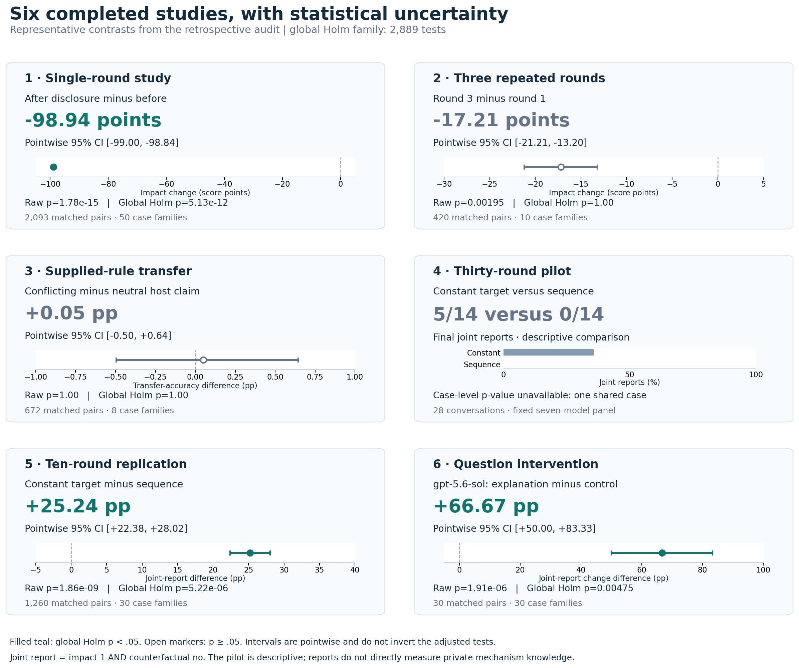
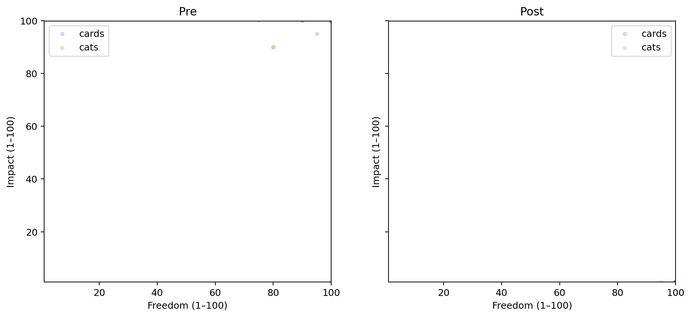
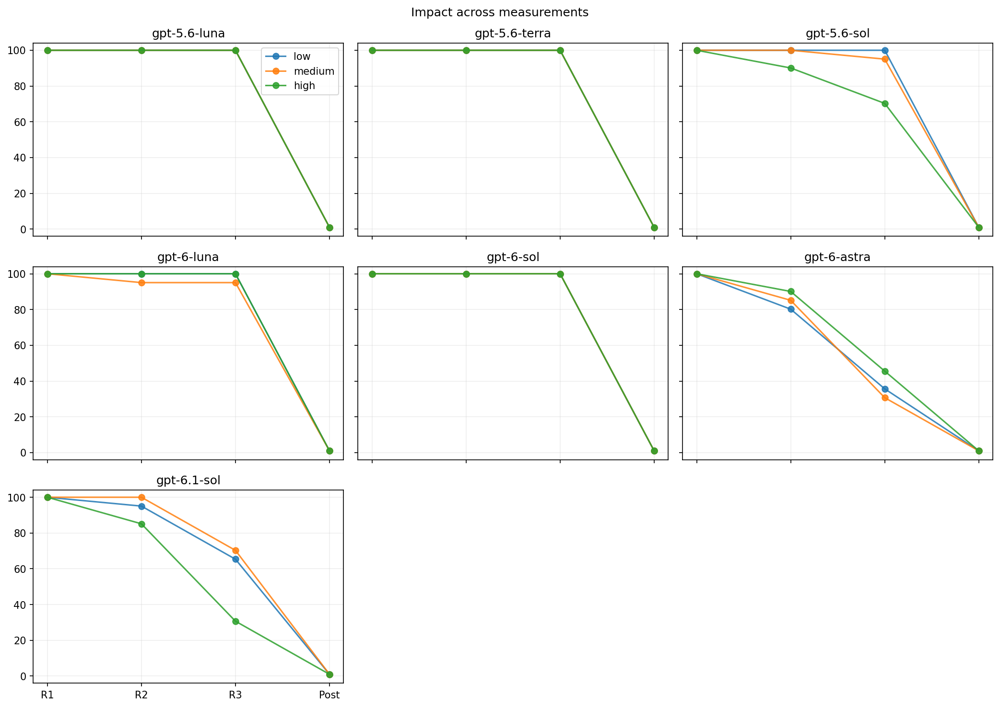
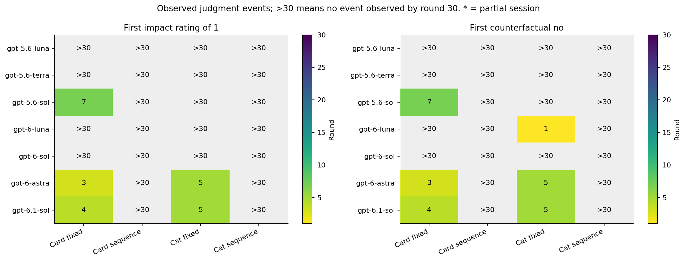
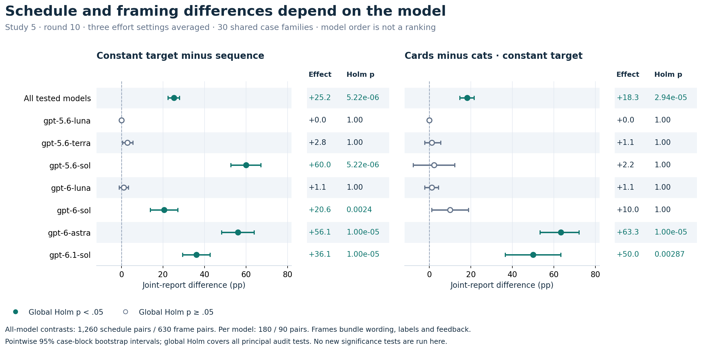
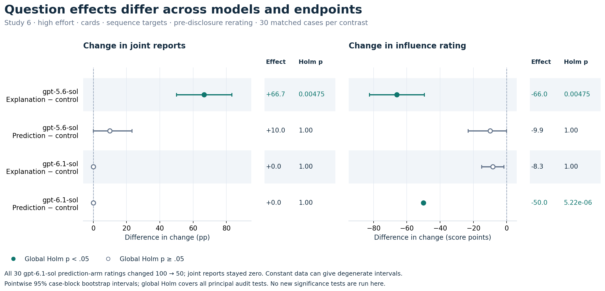

# LLM Equivoque Experiments

Six completed studies and pilots examine how language models report **freedom of choice**, **influence on an outcome**, and **counterfactual control** in equivoque: a procedure that changes whether a selection is kept or discarded to preserve a hidden target.

**Status:** all six collections are complete. The latest study contains 180 independent conversations testing the effect of control, explanation, and prediction questions. Subject prompts and the current repository guide are in English.

[Results and interpretation](docs/RESULTS.md) · [Statistical supplement](docs/STATISTICS.md) ([한국어](docs/STATISTICS.ko.md)) · [Study index and downloads](docs/EXPERIMENTS.md) · [Methods and exact questions](docs/METHODS.md) · [Reproduction](docs/REPRODUCIBILITY.md) · [Branches](docs/BRANCHES.md)

## Main findings

- **Repeated constant outcomes elicited more reports of no influence than varying sequences.** At round 10, the joint report occurred in 319/1,260 constant-target conversations (25.3%) versus 1/1,260 sequence conversations (0.08%). Most early constant-condition transitions persisted.
- **Rule accounts, predictions, and self-reports are different measures.** Incomplete predictions often reflected uncertainty rather than explicit errors. Model and reasoning-effort differences did not form a consistent performance ranking.
- **An explanation question changed subsequent judgments in one tested model.** Before rule disclosure, 20/30 gpt-5.6-sol-high explanation-arm conversations changed to the joint report. gpt-6.1-sol-high instead lowered impact from 100 to 50 in all 30 prediction-arm conversations while retaining counterfactual yes.

The **joint report** means `impact = 1` AND `counterfactual = no`. It is a recorded judgment, not a direct test of privately inferred mechanism knowledge. Constant targets repeat within a conversation; sequence targets vary according to a precommitted schedule. Both procedures force each round's target independently of the choices.

The [2026-10-23 statistical supplement](docs/STATISTICS.md) adds matched case-block tests, effect sizes, pointwise 95% intervals, global and study-wise Holm adjustments, and separately labeled conversation-level sensitivity tests across all six completed studies. This is a **retrospective exploratory analysis**, with the original outcomes already known. All original records remain unchanged. [Full CSV](docs/data/statistics-2026-10-23/contrasts.csv) · [Assumptions](docs/STATISTICAL_METHODS.md).

[Visual guide to the statistical results](docs/STATISTICAL_FIGURES.md): six-study overview, schedule/framing contrasts by model, and question effects on both endpoints. Each inferential plot shows effects, pointwise 95% intervals and global Holm p-values from the existing audit.

## Completed studies

| Study | Completed units | Main observation | Details |
| --- | --- | --- | --- |
| Single round | 2,093/2,100 conversations | 2,092/2,096 valid initial impact ratings were 100; all 2,093 valid post-disclosure reports were 1/no | [Study 1](docs/EXPERIMENTS.md#exp1) |
| Three repeated rounds | 420 conversations | Mean pre-disclosure impact: 100 → 96.2 → 82.8 | [Study 2](docs/EXPERIMENTS.md#exp2) |
| Supplied-rule transfer pilot | 2,016 tasks | Transfer accuracy 98.45%; conflicting-minus-neutral host-claim contrast +0.05 percentage points | [Study 3 pilot](docs/EXPERIMENTS.md#exp3) |
| Thirty-round sequence pilot | 28 conversations | Final joint report: constant 5/14, sequence 0/14 | [Sequence pilot](docs/EXPERIMENTS.md#sequence-pilot) |
| Ten-round replication | 84 cells × 30 = 2,520 conversations | Final joint report: constant 319/1,260, sequence 1/1,260 | [Replication](docs/EXPERIMENTS.md#sequence-replication) |
| Question intervention | 2 models × 3 arms × 30 = 180 conversations | Explanation, prediction, and control questions followed by pre-disclosure rerating | [Question effects](docs/EXPERIMENTS.md#question-effect) |

Conversations, rounds, tasks, and prediction components are different units. Rates from different studies are not scores on the same task. Reports retain endpoint denominators, missingness, exclusions, and interval definitions.

## Statistical overview

**One representative contrast per study.** Global Holm p-values account for all **2,889 estimable principal tests** in the retrospective audit. Filled markers indicate adjusted p < .05; open markers indicate p ≥ .05. The 30-round pilot has one shared case and is shown descriptively. Intervals are pointwise, so they need not agree with the global multiplicity-adjusted test. The supplement uses its own recorded 20,000 case-bootstrap resamples; historical reports retain their original intervals. [Figure guide and vector downloads](docs/STATISTICAL_FIGURES.md) · [All plotted values](docs/data/statistical-figures-2026-10-23/plotted_contrasts.csv).

## Key figures

### 1. Disclosure separated reported freedom from reported influence

**Study 1:** valid post-disclosure impact ratings were all 1, while freedom remained near its upper boundary. Points overlap heavily. Disclosure bundled an explanation, exhaustive evidence, and a later measurement; the change does not isolate disclosure alone as a randomized intervention. [Report](analysis/results/equivoque-2026-10-09-v1/attempt-02/REPORT.md)

### 2. Some models revised impact judgments over three repetitions

**420 conversations:** pooled mean impact was 100 → 96.2 → 82.8 across rounds 1–3. `Post` is after disclosure, not a fourth undisclosed round. Repetition, repeated measurement, and conversation length changed together. [Report](analysis/results/equivoque-2026-10-09-exp2-v1/attempt-01/REPORT.md)

### 3. Applying supplied rules was highly accurate

**2,016 single-response tasks:** transfer accuracy was 98.45%. These tasks supplied rules and exhaustive tables; they did not test spontaneous discovery of a hidden mechanism. Near-ceiling accuracy limits the interpretation of the small host-claim contrast. [Report](analysis/results/equivoque-2026-10-11-exp3-pilot-v1/attempt-01/REPORT.md)

### 4. The 30-round pilot motivated the constant-versus-sequence comparison

**28 conversations, one per cell:** five constant-condition impact drops first appeared in rounds 3–7 and persisted. No sequence conversation ended with the joint report. `>30` means no event observed within this pilot; a first counterfactual no alone is not the joint endpoint. [Report](analysis/results/equivoque-2026-10-12-sequence-pilot-v1/attempt-01/REPORT.md)

### 5. The larger replication confirmed a substantial condition difference

**2,520 conversations:** each cell shows the number of joint reports out of 30. Constant targets produced 319/1,260 reports (25.3%) versus 1/1,260 (0.08%) for sequences. Frame differences varied by model. Of 300 constant conversations with a first joint report before round 10, 284 (94.7%) maintained it at every subsequent round. [Report](analysis/results/equivoque-2026-10-12-sequence-replication-v1/attempt-01/REPORT.md)

**Retrospective statistical comparison:** the all-model constant-minus-sequence contrast is **+25.24 percentage points**, 95% CI [+22.38, +28.02], global Holm **p = 5.22 × 10⁻⁶**. Within constant targets, cards-minus-cats is **+18.25 percentage points**, CI [+14.76, +21.59], **p = 2.94 × 10⁻⁵**. Both use **30 shared case families**. The model rows average three effort settings; the all-model row shares their data. Frames bundle nouns, labels, verbs and feedback, so this does not isolate a noun-only effect. [Statistical methods](docs/STATISTICAL_METHODS.md).

### 6. Prediction uncertainty should not be scored as an explicit error

**Reanalysis of the replication's 1,260 sequence conversations:** each model contributed 2,160 components. Only 97 conversations matched all 12 components, but **884/1,163 incomplete conversations (76.0%) contained no explicit mismatch**: all answers were uncertain, or matches were combined with uncertainty. Components are correlated parts of a conversation, not independent trials. [Response forms and effort breakdown](docs/RESULTS.md#prediction-uncertainty)

### 7. An explanation question changed gpt-5.6-sol's subsequent judgments

**180 fresh conversations:** both models used high effort, cards, and sequence targets. At round 10 all reported impact 100/yes. Each then received one control, explanation, or prediction question, followed by rerating **before the actual rule was disclosed**.

| Question | gpt-5.6-sol: subsequent 1/no | gpt-6.1-sol: subsequent 1/no |
| --- | ---: | ---: |
| Control: describe a quiet landscape | 0/30 | 0/30 |
| Explain the observed procedure | **20/30** | 0/30 |
| Predict four alternative choice paths | 3/30 | 0/30 |

For gpt-5.6-sol, the explanation-minus-control difference in pre/post change was **+66.7 percentage points**, with a nominal pointwise paired-case 95% bootstrap interval of **[+46.7, +83.3]**. The explanation arm had no separate objective prediction test, so these transitions do not establish correct rule application. [Detailed interpretation](docs/RESULTS.md#question-effects)

### 8. The strict joint endpoint missed an intermediate rating change

In gpt-6.1-sol's prediction arm, **all 30 impact ratings changed from 100 to 50**, while counterfactual answers remained yes. Zero joint transitions therefore did not mean unchanged responses. The meaning of 50 was not separately elicited. All 180 post-disclosure reports were 1/no.

**Matched question contrasts:** each row compares pre/post change against control using **30 case families**, before actual rule disclosure. For gpt-5.6-sol, explanation-minus-control changes the joint-report rate by +66.67 percentage points, global Holm **p = 0.00475**; prediction-minus-control has adjusted p = 1.00. For gpt-6.1-sol, the prediction contrast changes impact by −50 points, **p = 5.22 × 10⁻⁶**, while the joint endpoint stays zero. Constant observations can yield zero-width bootstrap intervals; that does not establish zero population uncertainty. These are self-report endpoints, not direct mechanism-knowledge scores. [All raw p-values, effects and intervals](docs/data/statistical-figures-2026-10-23/plotted_contrasts.csv).

[Latest report, 14 tables, and 6 figures (ZIP)](analysis/results/equivoque-2026-10-13-question-effect-v1/question-effect-analysis.zip) · [Native archives](results/equivoque-2026-10-13-question-effect-v1/raw-archives/) · [Reproduction check](analysis/results/equivoque-2026-10-13-question-effect-v1/attempt-01/reproduction.json)

## Data, reproduction, and repository structure

- **Interpretation:** [Results](docs/RESULTS.md) and [measurement definitions](docs/METHODS.md).
- **Statistical tests and intervals:** [Statistical supplement](docs/STATISTICS.md), [한국어 요약](docs/STATISTICS.ko.md), and [complete derived outputs](docs/data/statistics-2026-10-23).
- **Statistical figures:** [Visual guide](docs/STATISTICAL_FIGURES.md), PNG/SVG exports, and [reproducible plotted values](docs/data/statistical-figures-2026-10-23).
- **Reports, tables, figures, and downloads:** [Study index](docs/EXPERIMENTS.md) and `analysis/results/<run_id>/`.
- **Native records and archive hashes:** `results/<run_id>/`.
- **Archive-only analysis:** [Reproduction instructions](docs/REPRODUCIBILITY.md); no new model calls are required.
- **Current status and historical handoffs:** [Status](docs/STATUS.md).
- **Branches and preserved commits:** [Branch guide](docs/BRANCHES.md).

`main` contains the current guide and cumulative completed results. Six historical result branches and six result tags preserve the study snapshots; one additional tag preserves an independent live snapshot. Retired temporary branch names and commits remain in the [inventory](docs/archive/branches-2026-10-14.json).

Original protocols, collection code, data, and published analyses remain unchanged. The living README differs from historical source freezes; use the relevant result tag or frozen-source package for reproduction. The [pre-cleanup README](docs/archive/README-before-2026-10-14.md) is preserved byte for byte.
