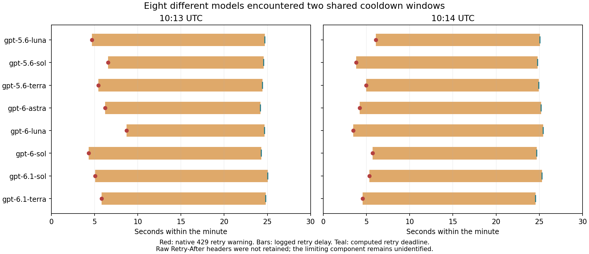

# 실험 7: CLI 업그레이드·속도 병목 조사

2026-11-08 UTC. 모든 실제 모델 호출은 별도 기술점검이며 본실험 표본에 포함하지 않는다.

**최신 CLI만 올려서는 처리량 문제가 해결되지 않았다. 가장 중요한 발견은
CLI 내부의 429 재시도가 RPC와 기존 stderr 계측에서 보이지 않았다는 것이다.**
재시도까지 감사하면 현재 확인한 가장 빠른 조건은 두 모델·6병렬·논리 입장
상한 100회/분의 **83.72 성공 턴/분**이다. 이것은 이 유한한 부하의 관측치이며,
GPT 서버 전체나 계정의 영구 최대 병렬 수를 뜻하지 않는다.

현재 실제 모델 호출과 본수집은 모두 중단돼 있다. 새 HALT는 해제하지 않았다.
기존 실험 7 수집분 전체를 다음 본실험의 주 분석에서 제외하는 사용자 결정을
현황판에 기록했으며, 원본·실패·미확정·freeze는 보존했다.

## 실제로 설치·비교한 버전

| CLI | 구분 | 같은 4병렬·80회/분 상한에서 관측한 속도 |
| --- | --- | --- |
| 0.159.0-alpha.3 | 기존 실행 버전 | 64.50, 68.13턴/분 |
| 0.167.0 | 공식 최신 안정판 | 66.95, 50.40턴/분 |
| 0.169.0-alpha.3 | 공식 최신 시험판 | 65.95턴/분 |

각 block은 Astra/5.6 Sol medium, cards/seq/en_schema, 새로운 대화 4개와
34턴이다. 기존판 → 안정판 → 시험판 → 안정판 → 기존판으로 비교했고,
운영 일시정지가 있었던 기존판 block 하나는 속도 비교에서 제외한 뒤 별도의
새 기술 block을 추가했다. [운영 기록](OPERATOR_DEVIATION.ko.md)을 보존했다.

동일한 2모델·6병렬·100회/분 설정에서는 이전 측정이 **83.65**, 최신 안정판이
**83.72턴/분**이었다. 큰 속도 개선의 근거는 없다. 안정판의 낮은 block에는
최대 43.23초의 긴 응답이 있었다. 표본이 작고 순차 비교이므로 특정 버전이
정확히 몇 % 빠르거나 느리다는 인과 추정으로 해석하지 않는다.

새 버전은 작업별 디렉터리에 분리 설치했고 npm archive의 SHA512 integrity와
바이너리 SHA256을 확인했다. 전역 CLI 및 기존 freeze의 지원 버전 상수는
수정하지 않았다. [설치 기록](results/installations.json).

각 버전의 실제 CLI를 로컬 가짜 서버에 연결한 34턴 fixture에서 프로세스와
대화 유지, schema on/off, 지침과 도구 표면, runner·감사·archive 계약을
검증했다. 다만 버전 사이에는 추가 도구 설명이 달랐다. 실험 질문·시스템 지침·
모델·effort가 같아도 전체 모델 입력이나 응답 분포가 동등하다고 주장하지 않는다.
[입력 비교](results/offline-cross-version-comparison-v2.json).

## 핵심: RPC 성공에 가려진 native 429

| 안정판의 부하 | 완료 대화 | 성공 턴 | RPC 429 | native 429 재시도 경고 | 판정 |
| --- | ---: | ---: | ---: | ---: | --- |
| 2모델·6병렬·100회/분 상한 | 6/6 | 204 | 0 | 0 | 이 부하 점검 통과 |
| 8모델·8병렬·160회/분 상한 | 8/8 | 272 | 0 | 16 | 429 없는 부하로 인정하지 않음 |
| 2모델·8병렬·110회/분 상한 | 8/8 | 272 | 0 | 10 | 429 없는 부하로 인정하지 않음 |
| 8모델·10병렬·200회/분 상한 | 10/16 | 395 | 0 | 30 | 발견 직후 중단, pending 6개 보존 |

경고 건수는 실제 HTTP 시도 수나 provider 내부 모델 실행 수가 아니다.
현재 meter도 논리 `turn/start`를 세며 CLI 내부의 HTTP/WS 재시도를 직접
세거나 pace하지 않는다. 설정 상한 200회/분이 실제 성공 처리량 200을 뜻하지 않는다.

원인은 두 겹이었다. 첫 WebSocket 재시도는 RPC 오류에 나타나지 않을 수 있었고,
상속한 `RUST_LOG=codex_exec_server=info,codex_cli=info,error`는 core의 WARN을
stderr에서 숨겼다. native SQLite에는 해당 경고가 남아 있었다.
`unbounded_connection_retries=false`는 무한 재시도만 끄며 기본 bounded
재시도를 끄는 옵션이 아니었다. 공식 0.167.0의 기본 stream 재시도 값은 5다.

8모델이 대기한 시각을 그리면 공통 제한 창이 보인다.

빨간 점은 native 429 재시도 경고, 막대는 로그에 기록된 대기 시간,
청록색 끝점은 두 값을 더해 계산한 재시도 예정 시각이다. 8개 모델 모두
첫 묶음은 10:13:24~25, 다음 묶음은 10:14:24~25 부근으로 모였다.

**계정이나 공통 접속 경로에 걸친 단기 제한의 강한 근거**다. 하지만 원본
Retry-After와 제한 header는 보존되지 않아 계정, IP, Cloud 프록시 중
정확히 어디인지 확정할 수 없다. 단순 RPM인지 토큰량 또는 다른 수용량
정책인지도 아직 구분되지 않는다. 공개 paid API의 한도를 Codex 로그인이나
구독 OAuth의 보장량으로 적용하지 않는다.

초기에 “8모델 점검 통과”라고 한 판정은 RPC 완료 기준이었다. 새 보고기는
native SQLite까지 감사하며 해당 부하를 429 없는 점검 통과로 표시하지 않는다.
원본 summary/RPC/응답은 고치지 않았다.
[정정 상세](NATIVE_RETRY_CORRECTION.ko.md) · [전체 표](results/TABLE.md) ·
[파생 수치와 원본 hash](results/metrics.json).

## 실행 코드에도 명시적인 병목이 있다

- **worker당 1초 간격:** 모델 하나를 맡는 worker는 최대 분당 60턴이다.
  8worker도 이론상 480턴/분이고, 초기화·대기·오류를 고려하면 더 낮다.
- **기존 전역 예약 상한 20:** 이 상태로 8VM × 각 10병렬을 모두 예약할 수 없다.
  예약 수를 늘리는 것과 서비스가 실제로 받아 주는 용량은 다른 문제다.
- **공유 SQLite 초기화:** 최신판 첫 실서버 실행에서 로컬 DB 초기화가 실패했다.
  인증 home은 그대로 두고 지원되는 `CODEX_SQLITE_HOME`으로 실험용 DB를
  분리한 뒤 직렬 초기화하는 기술 프로필로 해결했다. 기존 DB도 보존했다.
- **CPU·디스크:** 관측 부하에서 CPU 포화와 OOM 증거가 없었다. fsync 200회는
  평균 약 0.32ms였다. 현재 주된 처리량 저하를 디스크 성능으로 설명할 근거는 없다.

원래 전체 계획은 **77,856대화 × 34턴 = 2,647,104논리 턴**이다. 3일 완료에는
평균 **612.76턴/분**, 2일에는 **919.13턴/분**이 필요하다. 각 모델도 3일에
평균 76.59턴/분을 유지해야 하므로, 빠른 모델의 처리량만 높아도 충분하지 않다.
8worker의 1초 간격을 유지하면 오류가 전혀 없어도 최소 약 3.83일이다.

현재 확인한 83.72턴/분을 단순 대입하면 약 22일이다. 모든 모델·effort의
장시간 예측은 아니며, 더 높은 허용량을 확보하지 못한 현재 구성의 산술 추정이다.
실험 5의 약 127턴/분을 그대로 유지해도 새 전체 작업량에는 약 14.5일이 필요하다.
[구조별 분석과 개선점](METHOD_BOTTLENECKS.ko.md).

## 추가로 가능한 공식 경로

공식 문서에서 **ChatGPT 구독 OAuth로 공개 Responses API를 사용하는 경로**를
확인했다. 별도의 유료 API 키 없이 가능한 연동이지만, 실험 도구 이름으로
별도 OAuth 등록·사용자 승인을 받아야 한다. 기존 Codex 인증을 다른 클라이언트에
복제하지 않는다. 직접 클라이언트에서는 `max_retries=0`과 HTTP header·오류
본문 보존을 명시할 수 있고 CLI의 추가 도구 설명도 제거할 수 있다.

이것은 **같은 구독의 제한을 없애는 방법이 아니다.** 우리 계정의 처리량과
8모델 접근 권한은 아직 실측하지 않았다. 기존 app-server를 유지하는 공식
custom provider 설정도 문서에 있으므로 새로운 실행 프로필로 비교할 수 있다.
[공식 경로와 구체적 조건](OFFICIAL_RESPONSES_OPTION.ko.md).

전체 표본을 2~3일에 완료하려면, 입장 간격을 바꾸는 것과 함께 그 처리량을
실제로 지원하는 계정/경로의 용량을 검증해야 한다. 더 높은 한도의 paid API도
접근권·비용을 확인한 뒤 검토할 수 있다. 추가 과금 tier나 새 API 연결은
이번 조사에서 임의로 활성화하지 않았다. 조건·모델·effort·표본 수도 바꾸지 않았다.

## 저장·검증·현재 상태

- 실제 기술점검: **완결 대화 60개**, 기록된 성공 턴 **2,096개**.
  완결 대화 전부 원본 RPC·동일 PID/thread·34턴 감사 통과, 실제 도구 사용 0건.
- 모든 12개 실제 모델 stage의 원본과 native SQLite를 압축하고 private raw
  저장소에서 hash readback까지 확인했다. 중단된 10병렬 stage도 포함한다.
- private branch: `cli-upgrade/equivoque-2026-11-08-cli-upgrade-v1`,
  repository: `dasnidm/llm-equivoque-exp7-raw`.
- 로컬 원본: `/workspace/work/exp7-cli-upgrade-20261108`.
  현재 HALT와 6개 pending은 보존돼 있고, HALT 이후 새 논리 턴 입장은 0개였다.
  이미 진행 중이던 요청의 provider 내부 HTTP 시도 수는 추정하지 않는다.
- 기존 본 VM 수집 원본은 `/workspace/work/exp7-main-v2-worker-astra` 및
  `/workspace/work/exp7-persistent-v1-astra`에 남아 있다. 기존 수집을 사후에
  예비실험으로 재분류하지 않는다.
- 기존 freeze SHA256
  `16f61a400ff1280c54614719efb416df76fb5b696af47ee7b59342474ddbb75a`
  불변을 재검증했다. 새 본실험 수집은 시작하지 않았다.
- 코드 개선: native 로그의 엄격한 429 판정, 올바른 파생 운영 판정,
  향후 stderr WARN 노출, startup 전 HALT 거부를 추가했다. stderr 출력 수정은
  실제 CLI+가짜 429 서버에서 약 0.30초 내 경고가 보이는 것으로 검증했다.
  당시 RPC 오류는 0건이었다. 이 fixture의 외부 모델 호출도 0건이다.
- 기존 transport·audit 35개 검사 통과. 최신 CLI의 로컬 34턴 계약 검사 통과.
  문서 전체 검사는 기존 `EXP7_EXP5_SPEED_COMPARISON.ko.md`가 가리키는 미추적
  `EXP7_PERFORMANCE_DIAGNOSIS.ko.md` 링크 때문에 실패한다. 사용자 원래
  worktree의 미완료 변경을 이번 작업에 섞지 않았다.

[조사한 공식 문서·소스·공개 이슈](research_sources.json). 공개 이슈는 유사 증상
근거이며 우리 계정의 원인 확정 근거로 취급하지 않는다.
