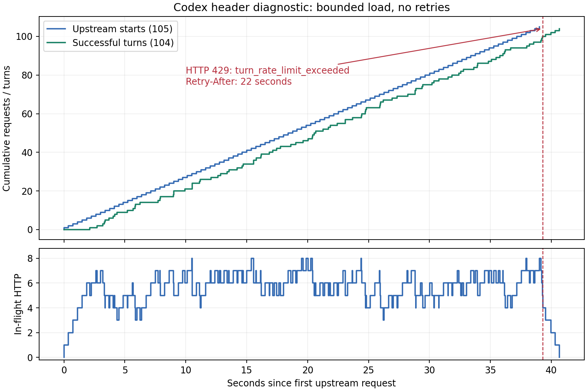

# 실제 Codex 429 응답 헤더 진단

2026-11-08 UTC. 사용자 요청: “헤더확인하는 테스트해봐 그리고 분석”.

**공식 Codex 응답 엔드포인트에서 `turn_rate_limit_exceeded` 429와
`Retry-After: 22`를 직접 확보했다.** 바로 직전 정상 응답의 주간 사용량은
68%였다. 주간 사용량이 남아 있어도 별도 단기 턴 제한이 작동한다는 근거다.
고정 RPM·TPM 수치와 제한의 정확한 적용 범위는 응답에 공개되지 않았다.

## 실제 오류와 헤더

429 수신 시각은 **2026-11-08 14:53:26.456972 UTC**였다.

```json
{"error":{"type":"rate_limit_error","code":"turn_rate_limit_exceeded","message":"Codex is at capacity, please try again later"}}
```

```text
HTTP status: 429
Retry-After: 22
x-oai-request-id: 797ec408-7547-4767-b6da-e52b45e85a2a
cf-ray: a575683ef830e6d4-LAX
x-envoy-upstream-service-time: 220
```

직전 정상 응답의 헤더 수신은 **14:53:26.358872 UTC**, 약 0.10초 전이다.

```text
x-codex-active-limit: premium
x-codex-plan-type: pro
x-codex-primary-used-percent: 68
x-codex-primary-window-minutes: 10080
x-codex-primary-reset-after-seconds: 1747
x-codex-primary-reset-at: 1794151352
```

`10080분`은 7일이다. 이 응답의 표시상 주간 잔여량은 약 32%이고,
주간 창의 리셋은 약 29분 뒤다. 429의 22초 대기와는 시간 척도가 다르다.
429 자체에는 이 주간 사용량 헤더가 없으므로, 직전 정상 응답과 구분해 인용했다.

`x-ratelimit-limit-*`, `x-ratelimit-remaining-*` 또는 이에 준하는 숫자 RPM·TPM
헤더는 이번 응답들에 없었다. `premium`이라는 이름만으로 모델 간에 정확히
어떤 버킷을 공유하는지 판단할 수 없다.

## 어떻게 확인했는가

[사전 기록](PLAN.ko.md)에 따라 별도 CLI 0.167.0과 기존 CLI 인증을 사용했다.
127.0.0.1 중계기가 기존 프록시·CA·TLS 검증을 유지한 채 고정된 공식
`https://chatgpt.com/backend-api/codex/responses`로 요청을 전달했다.
지원되는 custom provider 설정으로 HTTP/SSE, request 재시도 0,
stream 재시도 0을 명시했다. 이번 경로는 기존 본실험의 WebSocket과 다르다.

중계 로그에는 요청 헤더·본문 대신 해시와 크기만 저장했다. 응답은 제한·대기·
request ID 등의 허용된 헤더와 오류 본문을 보존했다. 정상 응답의 원본 RPC는
기존 격리 디렉터리에 보존하고 비공개 저장소에 백업했다.

외부 호출 전 실제 CLI와 가짜 로컬 서버로 다음 네 가지를 검증했다.

- 정상 SSE 전달.
- 실제 CLI에 429를 돌려줘도 HTTP 요청이 정확히 한 번만 발생함.
- 제한 헤더와 오류 보존, 인증·쿠키 제외.
- 서버가 인증값을 오류 본문·헤더에 반사해도 디스크와 CLI로 유출되지 않음.

오프라인 검증의 외부 모델 호출은 0회다. 실제 진단은 Astra와 5.6 Sol의
medium 조건에서 실행했다. 먼저 각 모델에 1턴씩, 총 2회의 canary가 성공했다.
그다음 원래 실험 질문·스키마·순서로 8개의 새 독립 대화를 시작했다.
목표는 대화 완결률이 아니라 첫 제한 응답의 확보이며, 최대 144요청으로 제한했다.
첫 upstream 오류를 받으면 새 요청을 차단하고 진행 중 응답만 보존했다.

## 측정 결과

| 항목 | 결과 |
| --- | ---: |
| 부하 진단의 설정 pool / 실제 동시 HTTP 최댓값 | 8 / 8 |
| 실제 동시 HTTP 시간 평균 | 5.55 |
| 최소 요청 시작 간격 / 설정상 시작 속도 상한 | 0.375초 / 분당 160회 |
| 공식 엔드포인트로 전달된 부하 요청 | 105회 |
| 정상 HTTP 200 / 성공 논리 턴 | 104 / 104 |
| 공식 엔드포인트의 HTTP 429 | 1회 |
| 첫 요청 시작부터 마지막 응답 종료까지 | 40.67초 |
| 성공 응답 지연 중앙값 / p95 | 2.19초 / 3.33초 |
| 첫 429 이후 로컬에서 차단한 HTTP 요청 | 3회 |
| STOP 기록 이후 새 upstream 요청 시작 | 0회 |
| native 429 재시도 경고 / 기타 재시도 경고 | 0 / 0 |
| canary 포함 전체 실제 응답 요청 | 107회 |
| 본실험에 포함한 표본 | 0 |

지연은 upstream 요청 입장부터 스트림 종료까지이며, CLI 시작과 로컬 입장 대기는
제외한다. p95는 inclusive 방식의 분위수다. 로컬 차단의 합성 503 세 건은
공식 서버의 오류나 추가 모델 실행으로 세지 않는다.



8개 대화는 모두 미완결 상태 그대로 보존했다. 상태 파일상 실패 4개는
공식 429 한 건과 로컬 차단 세 건에 대응한다. 다른 4개는 STOP을 확인한
사전 전송 가드에서 중단됐다. 실패나 미전송 pending을 재실행·대체하지 않았다.
성공한 104턴에서 실제 도구 이벤트는 0이었고, 각 대화의 성공 구간은
동일한 프로세스와 thread를 유지했다. 34턴 전체 완결 검증을 했다는 뜻은 아니다.

## 해석과 운영 판단

1. **이번 429는 Codex 엔드포인트가 반환한 단기 턴 제한이다.** 정확한 오류
   코드·본문과 request ID를 확보했다. 이전에 조사한 공개 사례의 코드·메시지와도
   일치한다. 계정의 주간 할당량 소진으로 설명하기는 어렵다.
2. **“전체 GPT 서버가 초당 몇 건밖에 처리하지 못한다”는 결론은 나오지 않는다.**
   용량·입장 제한의 적용 범위가 계정, 모델, 접속 경로 또는 여러 요소의 조합인지는
   이 헤더에 없다. 같은 계정으로 VM만 추가한다고 선형으로 빨라진다는 근거도 없다.
3. **105번째 요청이라는 숫자를 RPM 한도로 쓰면 안 된다.** 105회는 약 39초에
   시작한 이번 진단의 누적 수다. 단일 구간에서 고정 창, 이동 창, burst 허용량,
   모델별 가중치, 공유 트래픽을 분리할 수 없다. 39초 경과와 22초 대기는
   약 1분 창과 양립하지만, 60초 창이나 특정 RPM의 증명은 아니다.
4. **22초는 서버가 제시한 재시도 대기값이다.** 22초 뒤 성공 보장은 검증하지 않았다.
   이번에는 새 STOP을 남기고 종료했으며 재전송하지 않았다.
5. **짧은 성공 속도를 지속 처리량으로 사용하면 안 된다.** 104턴/40.67초는 환산하면
   분당 약 153턴이지만, 곧바로 429가 난 중단 전 구간이다. 이 값을 완료 시간
   추산이나 안정 운영 속도로 쓰지 않는다. HTTP/SSE 경로 차이도 있으므로 기존
   WebSocket 점검의 성능 개선으로 해석할 수 없다.

다음 본수집 프로필의 출발 후보는 이전의 **6병렬·계정 전체 합산 시작 상한
분당 100회** 점검이다. 당시 성공은 약 83.7턴/분, native 429 재시도 경고는
0건이었다. 이는 유한한 점검 결과이며 확인된 최대치나 장기 무오류 보장은 아니다.
여러 VM에서 각각 100회를 허용하는 대신, 같은 계정의 전송 시작을 합산해서
제어해야 한다. 이번 진단 결과만으로 본수집을 재개하거나 동결 실행 조건을 바꾸지 않았다.

## 보존·검증

- [재현 코드](analyze.py): 로컬 증거를 읽어 표·JSON·CSV·PNG를 재생성하며 모델 호출은 하지 않는다.
- [측정값과 백업 영수증](results/metrics.json), [선별 헤더·오류](results/headers-and-error.json),
  [요청 시각 CSV](results/timeline.csv).
- 원본 위치: `/workspace/work/exp7-header-probe-20261108-canary-v1` 및
  `/workspace/work/exp7-header-probe-20261108-load-v1`.
- 비공개 원본 저장소: `dasnidm/llm-equivoque-exp7-raw`,
  브랜치 `headers/equivoque-2026-11-08-exp7-header-probe-v1`.
  두 archive와 개별 파일 index를 원격에서 다시 읽어 SHA-256을 검증했다.
  최신 백업 commit: `6b205eb0e7b93dd3eb47f484d557100ec9ef9ba9`.
- 두 진단 모두 메모리에 보관한 실제 인증값에 대한 파일 검사가 통과했고,
  검사에서 건너뛴 파일도 0개다. 공개 결과에는 대화 원문·요청 인증·잔액을 넣지 않았다.
- 본실험 STOP과 이전 기술점검 HALT는 유지했다. 기존 연구 freeze SHA-256도
  `16f61a400ff1280c54614719efb416df76fb5b696af47ee7b59342474ddbb75a`로 유지됐다.
- 공통 조정 브랜치 `exp7/persistent-v1-coordination`의 `board.json`에
  `header_diagnostic_20261108` 메타데이터로 결과와 보고서·원본 백업 참조를 기록했다.
  본실험의 작업 배정·표본 집계·STOP은 바꾸지 않았다.
- 오프라인 헤더 진단 테스트 4개 통과. 실제 응답 원본, 실패·pending,
  기존 수집 결과는 삭제하거나 덮어쓰지 않았다.
- 분석 코드 실행·구문 검사와 새 링크 검증을 통과했다. 저장소 전체 문서 검사는
  기존 `docs/EXP7_EXP5_SPEED_COMPARISON.ko.md`의 `EXP7_PERFORMANCE_DIAGNOSIS.ko.md`
  누락 링크에서 실패한다. 이 파일은 원래 checkout의 별도 미추적 작업이므로
  이번 진단에 포함하거나 수정하지 않았다.

재현 명령:

```bash
python analysis/exp7_headers_20261108/analyze.py --root /workspace/work
```
