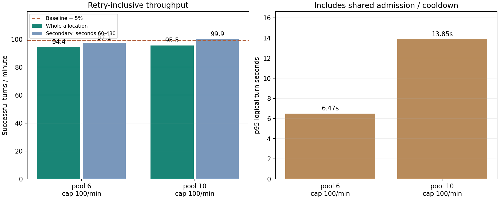
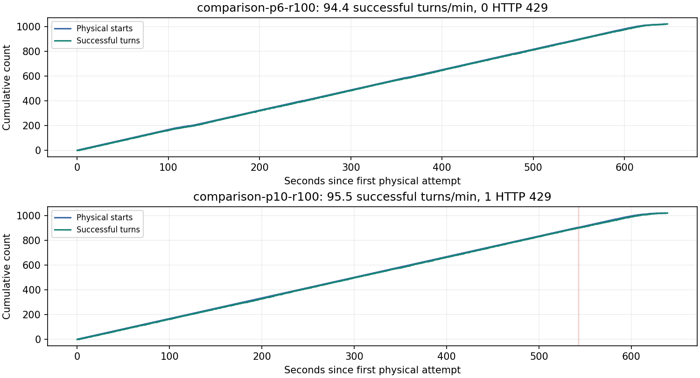
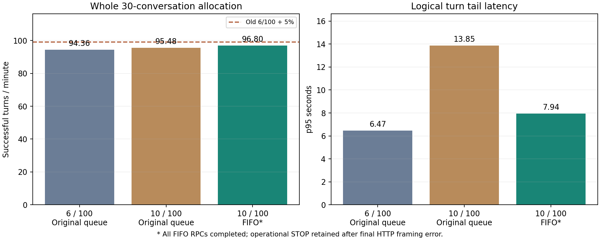

# 429 재시도와 평활화 전략의 실제 효율 검증

사용자 요청: “이거까지 감안해서 더 효율적인 방안 찾고 테스트해.
그리고 현재 실행전략 수정하는게 이득이면 수정해”.

**FIFO 입장 제어를 채택하고, 6병렬·계정 전체 합산 분당 100회 시작 상한을 유지한다.**
마지막 30대화 FIFO 검증의 10/100은 이전 6/100 대비 전체 처리량이 **+2.59%** 달랐다.
일시적인 명시적 capacity 429는 공통 대기 후 같은 논리 턴 안에서 복구하도록
새 실행 전략을 기록했다. 미확정 요청·응답 도중 오류의 자동 재전송과 기존 STOP 해제는 허용하지 않는다.

## 무엇을 실제로 했는가

새 기술 자료는 **126개 완결 대화 · 4,284개 성공 논리 턴**이다.
공식 엔드포인트로 보낸 물리 요청은 4,294회이고,
capacity 429 10건을 포함한다. 본실험 표본은 0이다.
Astra와 5.6 Sol medium, cards/seq/en_schema의 동일한 frozen 시작 설정·질문·스키마·순서를
각 설정에서 새 독립 대화로 실행했다. 모든 과학 결과와 원본은 별도 경로에 보존했다.

CLI 0.167.0의 persistent app-server를 사용하고, native request/stream 재시도는 0으로
설정했다. HTTP/SSE 중계기에서 완결된 `429 / rate_limit_error /
turn_rate_limit_exceeded`만 재시도했다. CLI가 보낸 `zstd` 본문과 헤더는 바꾸지 않고,
같은 요청 바이트를 메모리에서 다시 전달했다. 모든 작업과 재시도가 하나의
입장 간격과 cooldown을 공유했다. 응답 질문이나 `turn/start`를 추가하지 않았다.

외부 요청 전 가짜 서버 검증 7개, FIFO 수정 후 9개가 통과했다.
종료 오류 분류와 테스트 격리를 보완한 뒤 기존 감사·전송 테스트까지 함께 실행해
최종 오프라인 회귀 **49개**가 통과했다. 여기에는 34턴 중
두 차례 429 뒤에도 한 PID/thread와 정확한 질문 이력이 유지되는지,
압축 요청의 바이트 보존, 부분 200의 재전송 금지, quota 오류·인증값 반사의
재시도 금지, 재시도 예산·공통 대기 검증이 포함된다. 외부 모델 호출은 0이었다.

## 처음 12개씩 비교한 결과

| 설정 | 입장 대기줄 | 완결 대화 | 성공 턴/분 | 429 / 복구 | p95 턴 지연 |
| --- | --- | ---: | ---: | ---: | ---: |
| 6병렬 · 시작 상한 100/분 | 순서 미보장 | 12/12 | 90.07 | 0 / 0 | 6.97초 |
| 8병렬 · 시작 상한 110/분 | 순서 미보장 | 12/12 | 88.32 | 3 / 3 | 9.17초 |
| 10병렬 · 시작 상한 160/분 | 순서 미보장 | 12/12 | 87.08 | 3 / 3 | 25.34초 |

이 비교의 세 설정은 모두 12개 대화·408턴을 완료했고, 429도 모두 복구했다.
그러나 pool과 시작 속도를 함께 높이면 전체 완료 시간이 더 빨라진다는 결과는 없었다.
6/100, 8/110, 10/160의 공통 60~180초 구간 속도는 각각 93.5, 99.0, 100.0턴/분이었다.
이 시간 구간은 초기 진행 중 추가한 보조 진단이며 원래의 선택 지표를 대체하지 않았다.

12개가 6에는 두 묶음으로 나뉘고, 8·10에는 마지막 소수 대화가 남는 효과를 확인했다.
본수집 manifest는 **2,592개 작업이 30대화, 8개 작업이 12대화**였다.
이에 [추가 검증 방침](JOB_SIZE_AMENDMENT.ko.md)을 기록한 뒤, 새 v3에서
30개씩 비교하고 두 설정의 시작 상한을 동일하게 100회/분으로 맞췄다.
새 검증은 초기 결과를 숨기거나 덮어쓰지 않는 적응적 운영 점검이다.

## 실제 작업 크기에 맞춘 30개씩 추가 비교

| 설정 | 입장 대기줄 | 완결 대화 | 성공 턴/분 | 429 / 복구 | p95 턴 지연 |
| --- | --- | ---: | ---: | ---: | ---: |
| 6병렬 · 시작 상한 100/분 | 순서 미보장 | 30/30 | 94.36 | 0 / 0 | 6.47초 |
| 10병렬 · 시작 상한 100/분 | 순서 미보장 | 30/30 | 95.48 | 1 / 1 | 13.85초 |

두 설정 모두 30개 대화·1,020턴이다. 재시도·대기·마지막 대화 종료까지
성공 턴/분에 포함했다. 분모는 첫 논리 턴의 요청 시각부터 마지막 응답 수신까지다.
별도 무호출 대기, 종료 후 감사·압축·GitHub 업로드는 이 분모에 포함하지 않는다.
v3의 당초 후보 선택 기준은 전체 속도 5% 이상 향상, 공통 60~180초 속도 baseline 이상,
전체 완결·원본 감사·비공개 백업 통과였다.

그래프의 보조 속도는 첫 1분을 제외한 공통 60~480초 구간이다.
본수집처럼 긴 작업의 운영값을 판단하려고 함께 제시했다.
새 비교는 pool 확대와 시작 속도를 분리한 것이며, 10/160의 짧은 burst 속도를
10/100의 지속 처리량으로 간주하지 않았다.

## 채택한 실행 전략과 적용 범위

### 로컬 대기줄 문제를 발견한 뒤 마지막으로 고친 부분

v3의 HTTP 왕복 p95는 6/100 4.47초,
10/100 4.75초였다.
논리 턴 지연이 길어진 상당 부분은 서버에 보내기 전의 로컬 대기였다.
중계 구간에서 물리 처리와 알려진 재시도 대기를 뺀 근사 입장 대기 최대는
6/100 8.37초,
10/100 31.65초였다.
이전 구현은 줄에 먼저 온 작업을 보장하지 않았다.

[대기줄 수정 기록](QUEUE_AMENDMENT.ko.md)에 따라 FIFO로 고치고 새 v4에서
10/100·30개 새 대화를 마지막으로 한 번 검증했다. 기존 결과를 바꾸지 않았다.

| 설정 | 입장 대기줄 | 완결 대화 | 성공 턴/분 | 429 / 복구 | p95 턴 지연 |
| --- | --- | ---: | ---: | ---: | ---: |
| 10병렬 · 시작 상한 100/분 | FIFO | 30/30 | 96.80 | 3 / 3 | 7.94초 |

FIFO 입장 순서 감사는 통과했고, 직접 기록한 입장 대기의 p95는
4.44초, 최대는
5.79초였다.
병렬 수를 올리는 조건은 이전 6/100보다 전체 속도 5% 이상 향상과 이전 10/100보다
낮은 p95였다. FIFO 구현은 순서 역전·기아 방지를 위해 채택한다.
FIFO 소스의 실모델 검증은 10병렬에서 수행했다. 선택한 6/FIFO 자체의 처리량을 직접 측정한 것은 아니며, 기존 6/100의 94.36턴/분을 새 6/FIFO 실측값으로 표시하지 않는다.

마지막 v4에서는 모든 원본 RPC가 완결된 **82ms 뒤** HTTP 프레임 종료 오류가
발생해 운영 STOP이 남았다. **운영 게이트는 실패 상태 그대로 보존했다.**
완결 응답이 있다는 원본 감사와 운영 게이트 통과를 구분한다.
[별도 검토 기록](TRANSPORT_CLOSE_REVIEW.ko.md)과
[읽기 전용 판단 JSON](FIFO_POST_COMPLETION_REVIEW.json)을 추가했으며,
STOP을 해제하거나 요청을 재전송하지 않았다. 백업도 이미 검증됐다.

앞으로의 코드는 완전한 `response.completed` 프레임을 전달한 뒤의
HTTP 종료 프레임 오류를 별도 진단으로 기록한다. 완결 프레임 이전 오류는
그대로 불확실 상태로 중단하며 어떤 경우에도 200 응답을 재전송하지 않는다.
이 마지막 종료 처리 수정은 실제 CLI·가짜 서버에서 검증했고 추가 실모델
호출은 하지 않았다. 새 프로필의 readiness에 실제 수정 소스를 포함해야 한다.

- [실행 전략 JSON](results/recommended_execution_profile.json)과
  [VM 운영 지침](../../docs/EXP7_CAPACITY_RETRY_STRATEGY.ko.md)에 선택값을 저장했다.
- 알려진 capacity 429는 `Retry-After`와 짧은 jitter 뒤 같은 요청으로 복구한다.
  재시도 역시 계정 전체의 물리 요청 시작 예산을 소비한다.
- quota·인증·알 수 없는 오류와 200 이후 중단은 STOP 및 원본을 보존한다.
  한 논리 요청의 재시도는 최대 4회다. 재시도 예약 시 경과+다음 대기가 240초를
  넘으면 추가 예약하지 않고, CLI 논리 턴 timeout은 360초로 두었다.
- 여기의 pool은 병렬 대화/CLI 작업 슬롯이다. 원본 구간의 최대 동시 논리 턴은
  설정 pool과 일치했다. HTTP 스트림은 terminal 전달 직후의 짧은 종료 구간이
  겹쳐 pool보다 한 개 높게 측정될 수 있다. 모델 내부 실행 수로 해석하지 않는다.
- 현재 검증은 **한 VM·두 모델·medium** 조건이다. 다른 모델·effort의 최고 병렬 수나
  장기 안정성, 여러 물리 VM에서의 동일 처리량을 증명한 결과는 아니다.
- 같은 계정의 여러 VM은 pool·시작 예산을 합산해야 한다. 각 VM에 전체 상한을
  따로 부여하지 않는다. 현재 loopback 제어기는 해당 VM 안에서 공유한다.
- 새 helper와 기술점검 실행기를 구현했다. 기존 worker가 이 정책을 자동으로
  사용하도록 구 freeze나 readiness를 바꾸지는 않았다. 본수집 적용에는 새 실행 ID,
  동결 실행 프로필과 그 프로필에 맞는 모델별 readiness가 필요하다.

## 감사·보존과 한계

모든 성공 대화의 34턴, 원본 RPC·파일 해시·프롬프트·스키마·모델·effort,
동일 PID/thread와 실제 도구 사용 0건을 감사했다. HTTP 재시도는 같은 논리 요청의
본문 해시가 같고 명시적 거절 직후에만 발생했으며, 공통 cooldown 위반이 없었다.
native의 숨은 429/기타 재시도 경고도 0이었다. 이는 공급자 내부의 완전한
exactly-once 실행을 증명한다는 뜻은 아니다.

v1 첫 로컬 오류는 실모델 요청 0회로 종료됐고, 실패 상태와 STOP을 보존했다.
[압축 처리 수정 기록](COMPRESSION_AMENDMENT.ko.md)을 남긴 뒤 새 v2를 만들었다.
기존 main·CLI upgrade·header 진단의 STOP/HALT도 해제하지 않았다.
원래 연구 freeze는 `16f61a400ff1280c54614719efb416df76fb5b696af47ee7b59342474ddbb75a`로 유지됐다.

이전 native WS 점검의 8병렬 약 98.1턴/분은 재시도 시간을 포함한 관측값이다.
6병렬 83.7보다 약 17% 높았지만, 새로운 고정 workload의 보편적 이득이라고
해석할 수는 없다. 이번 측정은 실행 시각·작업 크기·전송 방식이 다르다.
모든 비교는 짧은 순차 점검이고 서버 상태와 응답 길이가 달라질 수 있다.
개별 턴을 독립 표본으로 취급한 유의성 검정이나 인과 효과 주장을 하지 않았다.
기존 WS와 새 HTTP/SSE의 응답 분포 동등성도 증명하지 않았으며 새 주 분석에 합치지 않는다.

원본은 `/workspace/work/exp7-retry-efficiency-20261108-v1`, `-v2`, `-v3-job30`, `-v4-fifo`에 남겼다.
비공개 저장소 `dasnidm/llm-equivoque-exp7-raw`의 각 `retry/<실행 ID>` 브랜치에서
archive·index를 다시 읽어 SHA-256을 검증했다. 공개 결과에는 인증값·잔액·대화 원문을 넣지 않았다.
개별 백업 영수증과 측정값은 [최종 JSON](results/metrics.json),
[초기 비교 JSON](results/screening-v2/metrics.json), [CSV](results/comparison.csv)에 있다.
FIFO 원본의 별도 측정값은 [v4 JSON](results/fifo-v4/metrics.json)에 보존했다.

분석 재현은 `python analysis/exp7_retry_efficiency_20261108/build_report.py`이며
로컬 증거만 읽고 모델 요청을 하지 않는다.
