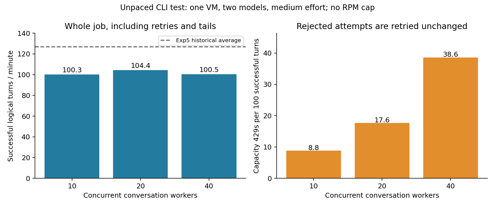

# 전송 상한 제거 + 429 재시도 처리량

2026-11-08. **최고 전체 관측값은 20병렬의 104.37 성공 턴/분**이었다.
10·20·40병렬의 지속 부하 예시 구간은 모두 약 100턴/분이었다.
한 물리 VM·두 모델·medium의 별도 기술 측정이며 본실험에는 포함하지 않는다.

## 실행 조건

[실행 전 계획](PLAN.ko.md)을 커밋한 뒤 새 대화만 시작했다.
Astra와 5.6 Sol을 반씩 배정하고 medium, cards, seq, en_schema,
한 대화의 전체 34턴을 유지했다. CLI는 0.167.0이며 실행 소스 커밋은
`942467a5a3241acd6c37bb25b11fe0c48f9748b8`이다.

모든 조건에서 CLI transport·relay gate·물리 admission의 시작 간격은
**0초**, 고정 분당 상한은 **없음(null)**이었다. 선착순 순서만 유지했다.
명시적 capacity 429이면 해당 요청만 Retry-After와 짧은 jitter 뒤에
동일한 바이트로 재시도했다. 다른 정상 요청에 공통 cooldown을 걸지 않았다.
native 내부 재시도는 0으로 유지했다.

첫 평가 요청 체크포인트부터 마지막 평가 응답까지 모든 재시도·대기를 포함했다.
사후 감사·압축·Git 업로드 시간은 이 처리량에 들어가지 않는다.

## 전체 완료 결과

| 병렬 대화 슬롯 | 완료 대화 | 성공 턴 | 평가 경과 | 성공 턴/분 | 429 / 복구 | 100성공턴당 429 | 턴 지연 p95 |
| --- | ---: | ---: | ---: | ---: | ---: | ---: | ---: |
| 10 | 20/20 | 680 | 406.83초 | **100.29** | 60 / 60 | 8.82 | 38.63초 |
| 20 | 20/20 | 680 | 390.92초 | **104.37** | 120 / 120 | 17.65 | 51.63초 |
| 40 | 40/40 | 1,360 | 811.72초 | **100.53** | 525 / 525 | 38.60 | 57.25초 |

**80대화·2,720턴을 모두 완료했다.** 물리 HTTP 시도는 3,425회이며,
그중 705회가 capacity 429였다. 모두 다음 한 번의 재시도에서 성공했다.
실패 시행 대체나 불확실한 응답의 재전송은 없었다. 본실험 추가 표본은 0이다.

20병렬의 전체 관측 속도는 10병렬보다 4.07% 높았다. 한 번씩의 유한한
작업 묶음이며 시작 시 서버 잔여 예산과 마지막 대화의 꼬리 효과가 다르다.
따라서 이 차이로 20을 모집단의 유일한 최적값이라고 결론 내리지 않는다.
40병렬은 표본도 두 배이므로 429 비교에는 개수와 표준화 비율을 함께 제시했다.



실험 5의 126.73턴/분 선은 다른 날짜·CLI·모델 혼합·전송·실패 정책의
역사적 참고값이다. 같은 조건의 무작위 성능 비교가 아니다.

## 지속 속도와 대기

시작 60초를 제외한 공통 120초 예시 구간(각 단계의 60~180초)은
10/20/40병렬에서 각각 **100.5/100.0/100.0턴/분**이었다.
탐색적 보조 지표이며 전체 완료 결과를 대신하지 않는다.

40병렬에서는 한 60초 구간에 실제 물리 시작이 **최대 230회**였다.
그런데도 성공 턴은 위와 같았다. 고정 100회/분 아래 측정한 결과와 구별된다.
일반 성공 HTTP 시도의 평균은 각각 2.55/2.53/2.92초였고,
429가 요구한 평균 대기는 35.14/47.85/48.75초였다.
adapter 측정 전 평균 구간은 0.04/0.07/0.09초였다.

이번 측정에서는 **실제 응답 제한에 따른 재시도 대기**가 처리량을 제약하는
양상이 확인됐다. 서버 내부 추론 시간, 공급자가 공개한 고정 RPM 한도,
다른 모델·effort·여러 VM의 절대 최대 처리량을 식별한 것은 아니다.

## 검증과 보존

- 80대화 전체 34턴 감사 통과. 모델·effort·프롬프트·스키마·질문 순서,
  대화별 동일 프로세스/thread, 실제 도구 사용 0을 확인했다.
- 설정 pool과 관측 논리 체크포인트 구간의 최대 중첩은 10/20/40으로 일치했다.
  HTTP 프레임 종료까지 센 최대 구간 중첩은 12/23/42였다. 응답 완료 전달 뒤의
  짧은 정리 구간이 다음 턴과 겹칠 수 있어 모델 내부 동시 추론 수로 해석하지 않는다.
- 재시도별 요청 바이트 동일성·순서, Retry-After 대기, FIFO 감사 통과.
  native 재시도 경고 기록 0, 모든 credential scan 통과.
- 20병렬에서 완전한 `response.completed` 전달 뒤 HTTP 종료 진단 1건이
  있었다. 검증한 종료 처리로 보존됐고 해당 요청은 재전송하지 않았다.
- 로컬 회복·동시성 테스트 11개 통과. 전체 34턴 대화, 정상 요청의 진행,
  불확실한 200 이후 재전송 금지를 검증했다.
- 기록된 native PID 80개는 모두 종료됐다. 원래 본실험 freeze SHA-256
  `16f61a400ff1280c54614719efb416df76fb5b696af47ee7b59342474ddbb75a`
  와 기존 전역 STOP을 유지했다. 본수집은 재개하지 않았다.
- 원본 RPC·SQLite·실패 응답과 운영 기록은 비공개 로그 레포
  `dasnidm/llm-equivoque-exp7-raw`의
  `retry/equivoque-2026-11-08-exp7-unpaced-retry-v1` 브랜치에 압축·원격 해시
  대조로 보존했다. 로컬 원본도 유지했다.
- 저장소 전체 문서 검사는 기존 `EXP7_EXP5_SPEED_COMPARISON.ko.md`의
  `EXP7_PERFORMANCE_DIAGNOSIS.ko.md` 누락 링크 때문에 실패했다.
  이번 변경과 무관한 기존 오류이며 관련 없는 문서를 대신 추가하지 않았다.

## 자료와 재현

[결과 JSON](results/metrics.json) · [CSV](results/metrics.csv) ·
[보존 검증](results/final-verification.json) · [백업 영수증](results/backup-receipts.json).
각 단계의 profile, summary, 대화 감사와 native 재시도 감사도 `results/`에 있다.

원본 작업 경로: `/workspace/work/exp7-unpaced-retry-20261108-v1`.
다음 재분석 명령은 새 모델 호출을 만들지 않는다.

```bash
PYTHONPATH=.:scripts python scripts/analyze_exp7_unpaced_sweep.py \
  --root /workspace/work/exp7-unpaced-retry-20261108-v1 \
  --output analysis/exp7_unpaced_retry_20261108/results --plot
```

수집 실행기는 `scripts/exp7_unpaced_sweep.py`다. 재수집은 새 경로와 실행 ID를
사용하며 종료된 대화를 resume하거나 기존 결과를 덮어쓰지 않는다.
