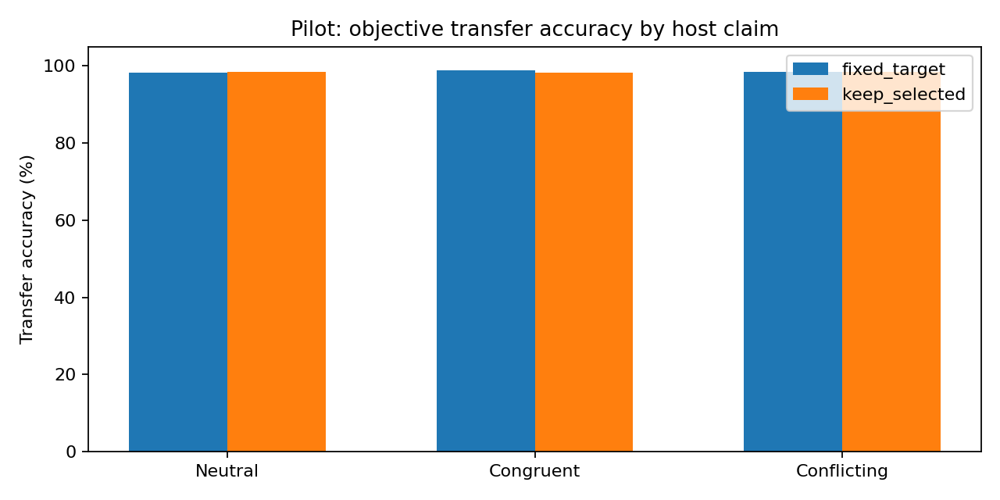
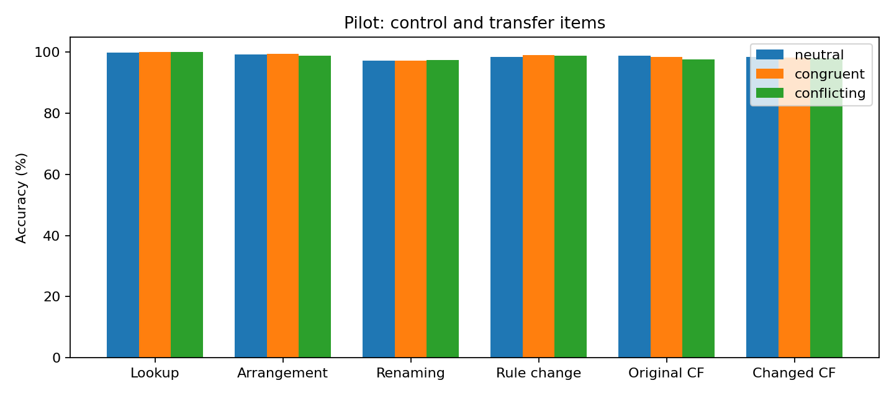
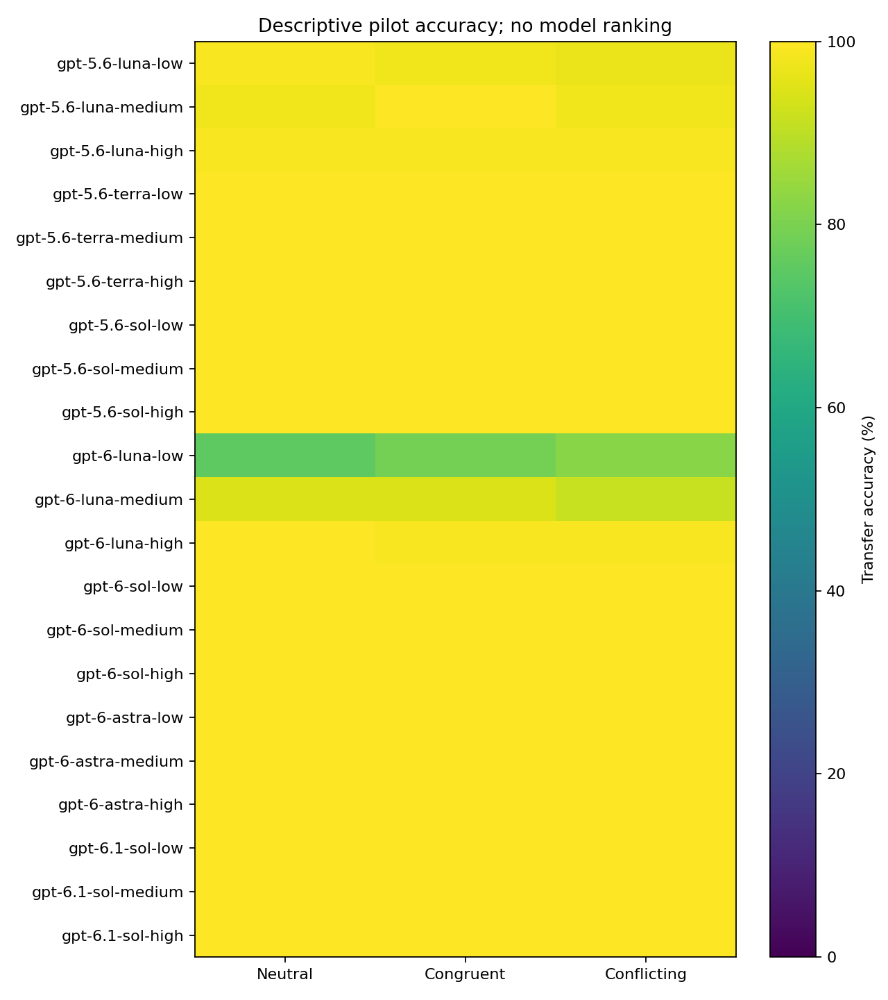
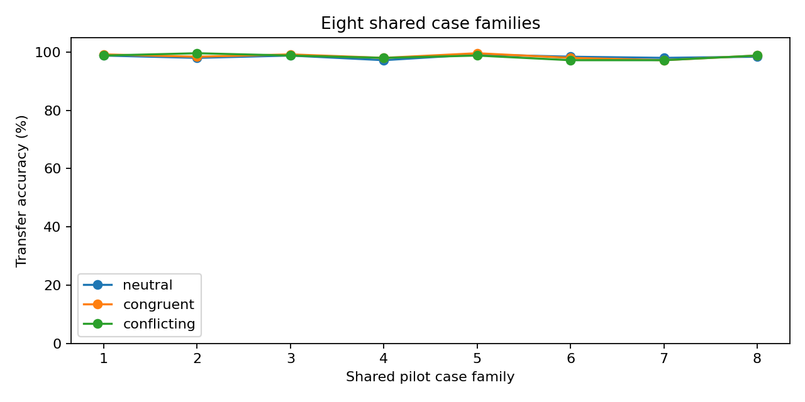
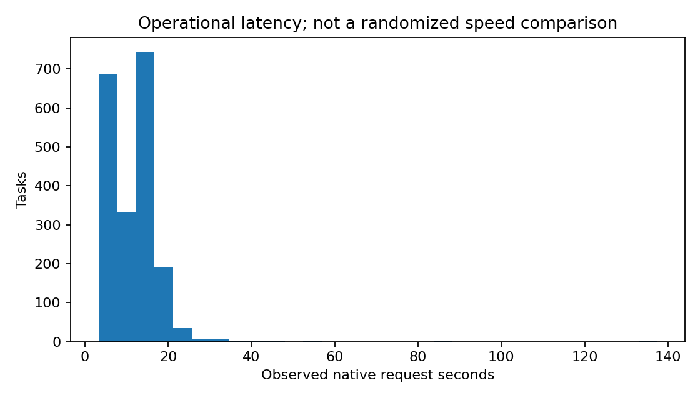

# Experiment 3 pilot report

Run `equivoque-2026-10-11-exp3-pilot-v1`. Pilot only: 2,016 assigned single-turn tasks, 21 requested model/effort configurations, two frames, two procedures, three host claims, eight matched case families. There were 2016 valid tasks; status counts: {"complete": 2016}. Four object questions and two binary counterfactual questions share one response and are not independent trials.

## Descriptive findings

Mean transfer accuracy (Questions 2–4): 98.446%. The prespecified conflicting-minus-neutral contrast is 0.050 percentage points, equally weighting configuration × frame × procedure cells and using matched valid case pairs. Supporting paired tasks: 672/672; cells: 84/84; shared case families: 8/8. Table lookup is a control and does not contribute to transfer accuracy. Question-level and condition-cell denominators are in the CSVs.

This is an exploratory screening pilot. It provides no confirmatory significance tests, model rankings, power guarantee, or isolated estimate of subjective choice freedom. The task tests responses to a fully supplied vignette, two candidate procedures, an exhaustive verified table, and a host opinion. A small effect may reflect ceiling accuracy or an ineffective opinion manipulation; it does not establish general resistance to social influence. Fixed-target and selection-retaining procedures are balanced, so always answering no achieves 50% on the original counterfactual.

## Integrity and runtime

Union audit passed: 2016 distinct evaluation sessions and 8064 verified native raw files. Frozen SHA-256: `95766c87c2cd8cdc6506942f53e81880cda778fcecd8897f4f7bf2a5576f5999`. Source revision and audit evidence are in provenance.json. Every task starts a fresh native Codex ChatGPT session, with zero offered tools verified in offline request-body inspections. Requested model/effort matches the catalog and inspected request; final CLI events do not independently attest the provider's internal model version. Raw usage, warnings, errors, exact prompts/schemas, and session IDs are preserved. The native CLI may retry HTTP internally; wire request counts and billing cost remain unknown.

Calibration: 43 native invocations, excluded. No uncertain task is replayed and no failed task is replaced. Missing answers stay missing. Operational concurrency observations are not a randomized throughput comparison. All earlier experiment data and canonical prompts remain unchanged.

## Next-step criteria

Review item-specific errors, paired claim sensitivity, case dependence, missingness, label/position patterns, and neutral accuracy before designing the main experiment. If accuracy is near ceiling, develop harder disjoint cases rather than silently expanding this pilot. Any main collection needs a separately frozen protocol and authorization. No Experiment 3 main trial or Experiment 4–7 task was collected.

## Figures and tables

