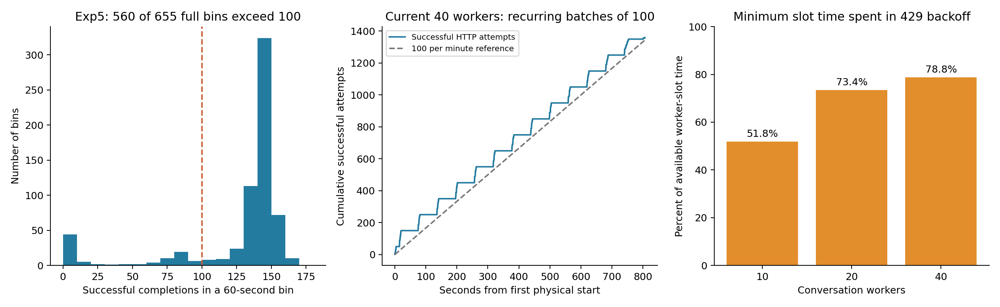

# 실험 5보다 느린 이유와 속도 개선 우선순위

2026-11-08. 기존 원본의 추가 분석이다. 새 모델 호출은 0회이며, 본수집·STOP·
freeze·실험 배정은 변경하지 않았다. 앞선 [설정 상한 재점검](EXP7_EXP5_THROUGHPUT_REASSESSMENT.ko.md)
이후 실시한 [상한 없는 10/20/40병렬 측정](../analysis/exp7_unpaced_retry_20261108/REPORT.ko.md)을
분석에 추가했다. 예전의 고정 100회/분 설정만으로 현재 결과를 설명하지 않는다.

**현재의 직접적인 병목은 capacity 429가 요구하는 대기다.** 클라이언트 전송
상한을 없애도 약 100개 성공 요청이 약 60초 주기로 반복된다. 실험 5에서는
100턴/분을 상당 시간 넘겼다. 다만 그 사이 어떤 계정·모델군·접속 경로·서버
정책이 달라졌는지는 현재 기록만으로 확정할 수 없다.

## 과거와 현재의 속도

| 실행 | 성공 턴 | 전체 성공 턴/분 | 성공 HTTP 시도의 평균 시간 | 429 요구 대기 평균 |
| --- | ---: | ---: | ---: | ---: |
| 실험 5 전체 | 83,160 | **126.73** | 같은 계측 없음 | 같은 계측 없음 |
| 현재 10병렬 | 680 | **100.29** | 2.55초 | 35.14초 |
| 현재 20병렬 | 680 | **104.37** | 2.53초 | 47.85초 |
| 현재 40병렬 | 1,360 | **100.53** | 2.92초 | 48.75초 |

현재 측정은 한 VM, Astra·5.6 Sol, medium, 각 대화 34턴이다. 실험 5는 다른
날짜와 모델·effort 혼합, CLI·전송·실패 정책에서 얻은 역사적 비교값이다.
실험 5는 마지막 상태 기록까지, 현재는 첫 평가 체크포인트부터 마지막 평가
응답까지 계산했다. 전체 처리량에는 각 실행의 대기와 재시도를 포함한다.

현재 최댓값 104.37은 실험 5 평균보다 약 17.6% 낮다. 20병렬이 10병렬보다
4.1% 높지만 반복하지 않은 유한한 작업 묶음의 차이여서 유일한 최적 병렬 수를
정한 결과는 아니다. 40병렬에서는 성공 100턴당 429가 38.60건으로,
10병렬의 8.82건보다 많아졌다.

## 새로 확인한 제한 주기

40병렬의 성공 HTTP 요청을 시작 시각 순으로 놓고, 다음 성공 요청까지 10초
넘게 벌어진 곳에서 묶음을 나눴다. 이는 사후 탐색적 기준이다. 묶음 크기는
`50, 100, 100, …, 100, 10`이며, **100개짜리 묶음이 13번 연속** 나타났다.
그 13개 묶음의 시작 간격 12개는 중앙값 **60.465초**, 범위 60.284~60.573초다.
처음과 마지막 묶음은 관측 경계와 서버 잔여 예산의 영향을 받을 수 있다.

429 응답은 `rate_limit_error / turn_rate_limit_exceeded`이고 `Retry-After`를
제공했다. 40병렬에서 물리 요청 시작이 한 60초 구간에 최대 230회였으므로,
우리 코드가 요청을 100회 아래에 묶어서 생긴 결과가 아니다. 고정 간격·분당
상한·공통 cooldown을 제거한 상태에서도 이 주기가 남았다.

이는 현재 계정/경로에서 **성공 요청 수에 관련된 짧은 시간창의 제한**을 강하게
시사한다. 응답 헤더에 공식 한도 `100`이 선언된 것은 아니다. 계정 전체,
모델 공유군, 접속 게이트웨이 중 어디에 적용되는지와 다른 날짜에도 유지되는지는
미확정이다. UTC 정각에 초기화되는 고정 분당 한도라고 단정하지 않는다.

실험 5도 같은 단위로 다시 살폈다. 첫 성공 완료부터 60초씩 나눈 완전한
655개 구간 중 **560개(85.5%)가 100턴 초과**였고 중앙값은 **142턴**이었다.
마지막 불완전 구간은 제외했다. 따라서 과거의 126.73은 시작 직후의 짧은
폭주 구간만 보고 얻은 값이 아니다.



왼쪽은 과거의 **완료 시각**을 세고 가운데는 현재의 **성공 HTTP 시작 시각**을
센다. 동일한 시계열 통계량으로 혼동하지 않는다. 오른쪽은 각 작업 슬롯의
최소 요구 대기를 합산하여 `병렬 수 × 전체 경과 시간`으로 나눈 값이다.
10/20/40병렬에서 각각 **51.8% / 73.4% / 78.8%**다. 동시에 기다리는 슬롯을
각각 센 값이며, 대기를 없애면 벽시계 시간이 그 비율만큼 줄어든다는 인과적
시간 절감 추정은 아니다.

## 어디까지 원인이 좁혀졌나

| 후보 | 현재 근거와 판단 |
| --- | --- |
| 우리가 건 100회/분 상한 | 이전 94~97턴/분 비교에는 적용됐다. 최신 비교에서는 제거했으므로 최신 결과 전체의 설명이 될 수 없다. |
| 개별 응답이 오래 걸림 | 최신 정상 HTTP 시도는 평균 2.5~2.9초다. 긴 429 대기와 구별해야 한다. 모든 모델·effort가 이 속도라는 뜻은 아니다. |
| VM CPU·디스크·Git 저장 | 기존 점검에서 CPU 포화/OOM 증거가 없고 fsync p95는 약 0.50ms였다. 최신 adapter 전 구간 평균도 0.04~0.09초다. 현재 부하에서 수십 초 대기의 주된 설명으로 보기 어렵다. |
| HTTP 중계기만의 문제 | 그 이전 native WebSocket의 8모델 측정에서도 공통 재시도 해제 시각과 약 96~110턴/분이 관측됐다. 중계기만으로 모두 설명되지 않는다. |
| 두 모델만 사용한 문제 | 8모델 native 측정에서도 비슷한 제한 양상이 있었다. 다만 이번 상한 없는 완결 비교는 두 모델만 검증했다. |
| 최신 CLI의 회귀/전송 경로 차이 | 기존 버전 비교는 4~6병렬·낮은 입장 상한이었다. 최대 부하의 버전/경로 효과를 분리하지 못했으므로 완전히 배제할 수 없다. |
| 계정·경로·당일 서비스 정책 차이 | 현재 제한 주기를 잘 설명하는 후보지만, 과거 헤더·동일 계정 식별 자료가 없어 정확한 적용 범위나 변경 시점을 확인할 수 없다. |

현재의 빠른 성공 응답 시간과 과거 exec/resume의 전체 adapter 시간을 그대로
빼서 “프로세스 초기화가 몇 초”라고 계산하지 않는다. 포함하는 구간이 다르다.
`envoy`, 요청 ID와 upstream 시간 헤더도 특정 계층이 한도를 정했다는 증명은 아니다.
이 결과는 GPT 서버 전체의 처리 능력이 100턴/분이라는 뜻이 아니다.

## 개선 우선순위

### 1. 현재 경로에서는 완료 가능한 재시도를 유지하고 과도한 병렬을 줄인다

명시적 응답 시작 전 capacity 429만 동일 바이트로 재전송하고, 서버의
Retry-After를 지키는 복구는 705/705건을 다음 시도에서 완료했다. 이로써
한 번의 429가 전체 실행을 중단하던 손실은 줄일 수 있다. 응답 처리 여부가
불확실한 요청과 quota/인증 오류를 같은 방식으로 반복하지 않는다.

측정된 두 모델·medium에서는 10~20개가 거의 같은 성공 처리량을 냈다.
40개로 늘리는 이점은 없었다. 모든 모델·high effort에서도 10개면 충분하다고
일반화할 수는 없다. 슬롯을 채워도 서버의 공통 허용량이 같다면 VM 추가도
처리량을 배수로 만들지 않는다. 이 분석에서 실행 중인 정책이나 고정 상한을
새로 적용하지 않았다.

### 2. 다음 검증은 병렬 수 확대보다 예전 방식과의 동시대 대조가 유용하다

가장 직접적인 미해결 질문은 “**오늘 실험 5 방식으로 돌려도 약 100에 묶이는가?**”다.
다음과 같이 별도 성능 대조를 설계할 수 있다. 아직 실행한 결과는 아니다.

- 같은 계정·VM·모델/effort·질문·스키마·실제 pool로 예전 exec/resume과
  persistent를 비교한다. 첫 비교는 실행 방식 묶음의 차이를 보는 운영 대조다.
- 차이가 나면 같은 CLI 버전·provider 경로에서 프로세스 유지 여부를 바꾸고,
  이어 버전과 WS/HTTP를 하나씩 바꾼다. 실제 wire 입력과 내부 retry도 기록해
  다른 요인이 함께 변한 비교를 단일 원인으로 해석하지 않는다.
- A/B와 B/A 순서를 반복하고, 각 묶음은 예를 들어 독립 대화 30개 × 34턴으로
  완결한다. 4묶음이면 4,080턴이다. 전체 완료율과 고정한 관측 구간의 처리량,
  성공/물리 요청 수, 429 종류·재시도·지연을 함께 남긴다.
- 두 방식 모두 같은 제한이면 현재 서비스/계정/공통 경로 쪽 근거가 강해진다.
  한 방식만 지속적으로 빠르면 버전·입력·전송 차이를 분해할 가치가 있다.
- 사용자 로컬 PC의 공식 클라이언트와 Cloud를 비교하면 경로 범위를 더 좁힐 수
  있다. 지원되는 정상 로그인과 네트워크 설정을 사용하며 Cloud 프록시를 우회하지 않는다.

과거와 현재 계정이 동일했는지도 원본만으로 확인하지 못했다. 지원팀 확인용
429 요청 ID·UTC·Retry-After 예시는 [계산 JSON](data/exp7-throttle-diagnosis-20261108/diagnosis.json)에
저장했다. 문의는 보내지 않았다. 확인할 질문은 한도의 적용 범위, 시간창,
정상적인 증설 경로다.

### 3. 수배 개선에는 더 높은 허용량이 검증된 API 경로가 필요하다

[공식 API 한도](https://developers.openai.com/api/docs/guides/rate-limits)는
조직·프로젝트·모델별 RPM/TPM과 공유 모델군을 구별한다. 문서의 Build 예시는
Astra/Sol/Terra에서 5,000 RPM·1,000,000 TPM이다. 이는 우리 조직의 실제
한도나 8모델 접근권을 확인한 값이 아니며, 무료 크레딧이 해당 등급을 자동
보장하지도 않는다. 높은 RPM이어도 토큰 한도와 느린 모델이 병목일 수 있다.

비용이 제한된 상황에서 확인할 새 선택지가 있다.
[적격 Pro·Business 구독의 API 크레딧 혜택](https://developers.openai.com/api/docs/guides/chatgpt-api-credits)은
Pro 월 $100/$200/$500 등급에 대응하는 크레딧을 안내한다. 유료 구독 7일,
구독·API 조직 소유권 등 자격을 충족하고 조직을 연결해야 한다. 직접 Responses
API에는 쓸 수 있지만 **Codex에서 API 키를 쓰는 사용량은 혜택 대상이 아니다**.
구독 로그인 Codex 한도도 올려주지 않는다. 우리 계정의 자격·잔액은 확인하지
않았고 연결·결제도 수행하지 않았다. 전체 실험 예산을 충당한다는 근거는 없다.

따라서 실제 8모델 접근권·RPM/TPM·잔액을 확인하고, 직접 Responses의 작은
성능 표본으로 비용과 처리량을 추정하는 것이 현실적인 다음 단계다. 구독 OAuth로
같은 API 주소를 호출하는 방식과 API 조직 크레딧을 사용하는 방식은 구별한다.
현재 토큰을 다른 클라이언트로 복제하거나 API 주소만 바꾸면 한도가 늘어난다고
가정하지 않는다. 직접 API 전환은 새 실행 프로필과 입력/대화 감사를 필요로 하며,
기존 수집분에 섞지 않는다.

[Fast mode](https://developers.openai.com/api/docs/guides/fast-mode)는 API의
같은 모델 Standard 처리와 rate limit을 공유한다. 토큰 생성이 빨라져도
요청 허용량 병목의 직접 해결책은 아니다. CLI 업데이트만으로 6배 속도를
얻을 근거도 현재는 없다.

## 전체 완료 시간과 분당 속도는 별개의 문제

현재 전체 설계는 **77,856대화 × 34턴 = 2,647,104턴**이다. 실험 5의
83,160턴보다 약 31.8배 많다. 표본을 유지하면 다음 산술이 성립한다.

| 가정 | 중단 없이 처리하는 시간 |
| --- | ---: |
| 100 성공 턴/분 | 18.38일 |
| 실험 5 평균 126.73 성공 턴/분 | 14.51일 |
| 3일 내 완료 | 평균 **612.76 성공 턴/분** 필요 |

이는 처리량이 전체 모델·effort에서 유지된다는 가정이며 장애·백업·정비 시간을
더하지 않았다. 실험 5 속도를 회복하는 것만으로 2~3일 목표에 도달하지 않는다.
요청 합치기, 라운드·조건·표본 감축은 설계 변경이므로 이 분석에서 수행하지 않았다.

## 재현과 검증

[분석 코드](../scripts/analyze_exp7_throttle_windows.py),
[수치·원본 해시·요청 ID](data/exp7-throttle-diagnosis-20261108/diagnosis.json),
[실험 5의 분당 완료 CSV](data/exp7-throttle-diagnosis-20261108/exp5_minute_completions.csv)를
함께 저장했다. 현재 raw 원본의 백업 위치와 감사 결과는
[상한 없는 측정 보고서](../analysis/exp7_unpaced_retry_20261108/REPORT.ko.md)에 있다.

```bash
python scripts/analyze_exp7_throttle_windows.py \
  --raw-root /workspace/work/exp7-unpaced-retry-20261108-v1
```

새 모델 호출 없이 보존 원본을 읽는다. 10초 묶음 기준은 탐색적이며 통계적
가설검정이나 공식 한도 추정값으로 제시하지 않는다. 공식 문서는 2026-11-08에
확인했으며 계정별 적용과 향후 변경 가능성은 실제 console에서 확인해야 한다.

코드 실행·원본 해시·JSON/CSV·공백 검사를 확인한다. 저장소 전체 문서 검사에는
기존 `EXP7_EXP5_SPEED_COMPARISON.ko.md`의 `EXP7_PERFORMANCE_DIAGNOSIS.ko.md`
누락 링크가 남아 있으며 이번 변경에서 관련 없는 문서를 대신 추가하지 않는다.
