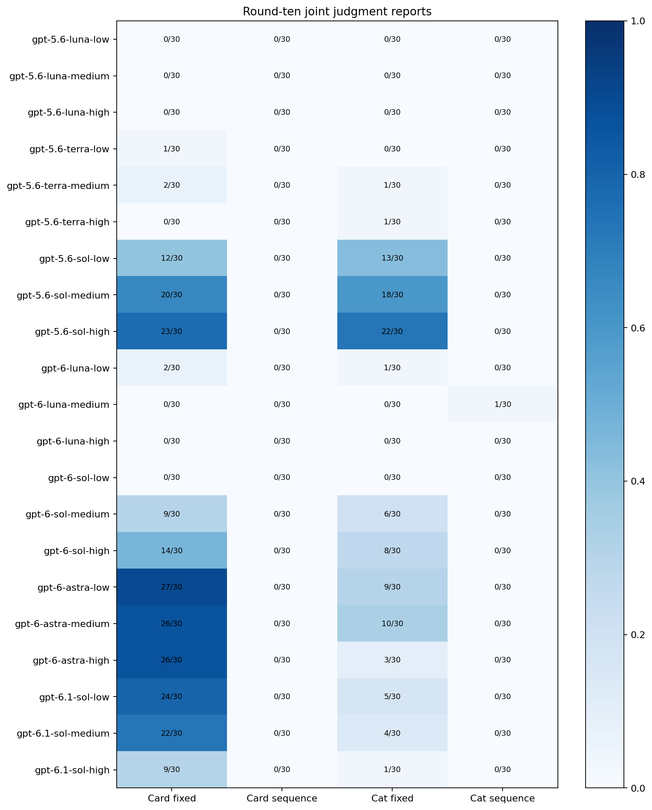
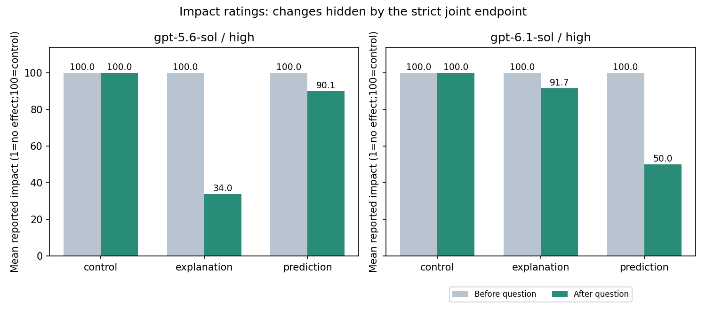

# 누적 결과와 해석

이 문서는 기존 보고서를 연결하는 현재 해석입니다. 배포 당시 보고서·표·원본은 그대로 보존합니다. 출처와 설계 차이는 [실험 목록](EXPERIMENTS.md), 문항은 [측정 안내](METHODS.md)에 있습니다.

## 반복·조건·유지

한 번의 게임에서는 대부분 영향력100이었습니다. 세 번 반복하면 평균 영향력이100→96.2→82.8로 낮아졌고, 이후 고정/시퀀스를 비교한 실험에서는 조건 차이가 분명했습니다.

| 대규모 반복:10라운드 종료 | 1·No /대화 | 비율 |
| --- | ---: | ---: |
| 고정 목표 | 319/1,260 | 25.3% |
| 변화 시퀀스 | 1/1,260 | 0.08% |
| 카드·고정 목표 | 217/630 | 34.4% |
| 고양이·고정 목표 | 102/630 | 16.2% |

고정 조건에서10라운드 이전에 처음1·No를 보인300개 중284개(94.7%)는 이후 모든 라운드에서도 유지했습니다.16개는 한 번 이상 되돌아갔습니다. 시퀀스에서 중간에1·No를 보인9개는 모두 한 번 이상 되돌아갔습니다. 이른 전환의 유지와 마지막 라운드의 응답은 다른 통계입니다.

프레임 차이는 일정하지 않았습니다. 고정 조건의gpt-5.6-sol-high는 카드23/30·고양이22/30, gpt-6-astra-high는 카드26/30·고양이3/30이었습니다. 높은 추론도 일괄적으로 공동 응답을 늘리지는 않았습니다. 두 프레임을 합쳐gpt-5.6-sol은low25→medium38→high45개/60개, gpt-6.1-sol은29→26→10개/60개였습니다. 이를 일반 지능 순위로 읽지 않습니다.

## 예측 완전 일치와 판단 유보

대규모 실험의 예측은 **절차 설명 질문을 받은 뒤, 실제 규칙 공개 전**에 답했습니다. 시퀀스의12/12일치는97/1,260개(7.7%)였습니다. **나머지92.3%를 모두 틀렸다고 부르면 부정확합니다.**

| 완전 일치하지 않은1,163개의 형태 | 시행 수 | 이 집단 내 비율 |
| --- | ---: | ---: |
| 12항목 모두 유보 | 541 | 46.5% |
| 부분 일치+유보, 확정적 불일치 없음 | 343 | 29.5% |
| 불일치 포함, 유보 없음 | 230 | 19.8% |
| 불일치와 유보 모두 포함 | 49 | 4.2% |

이 집단의884/1,163개(76.0%)는 확정적으로 불일치한 예측이 없습니다. 0항목 일치542개 중541개는 전부 유보했고, 나머지1개도8항목 유보·4항목 불일치였습니다. 12항목 전부 확정적으로 불일치한 시행은 없었습니다.

### 모델별 답변 형태

각 모델180대화 기준이며 네 형태는 서로 겹치지 않습니다. “불일치 포함”에는 유보가 있는 경우와 없는 경우가 모두 들어갑니다.

| 모델 | 12/12일치 | 전부 유보 | 부분 일치+유보, 불일치 없음 | 불일치 포함 |
| --- | ---: | ---: | ---: | ---: |
| gpt-5.6-luna | 7 | 69 | 36 | 68 |
| gpt-5.6-terra | 3 | 83 | 43 | 51 |
| gpt-5.6-sol | 87 | 15 | 13 | 65 |
| gpt-6-luna | 0 | 74 | 18 | 88 |
| gpt-6-sol | 0 | 101 | 74 | 5 |
| gpt-6-astra | 0 | 100 | 78 | 2 |
| gpt-6.1-sol | 0 | 99 | 81 | 0 |

[기계 판독 CSV](data/sequence-response-forms.csv). gpt-6.1-sol의 전체2,160항목은324일치·1,836유보·0불일치였습니다. 완전 일치0건이 규칙을 전혀 이해하지 못했다는 뜻은 아닙니다.

### 추론 수준별 유보

전체 예측 항목 중`uncertain`의 비율입니다. 모델·추론별60대화 ×12항목 =720항목 기준입니다.

| 모델 | Low | Medium | High |
| --- | ---: | ---: | ---: |
| gpt-5.6-luna | 65.8% | 49.7% | 54.2% |
| gpt-5.6-terra | 61.9% | 64.2% | 62.6% |
| gpt-5.6-sol | 6.1% | 8.9% | 25.0% |
| gpt-6-luna | 83.3% | 59.2% | 15.8% |
| gpt-6-sol | 82.8% | 81.7% | 87.2% |
| gpt-6-astra | 85.0% | 82.5% | 86.7% |
| gpt-6.1-sol | 85.6% | 86.7% | 82.8% |

[21조합 CSV](data/sequence-uncertainty-by-effort.csv). gpt-6-sol·astra·6.1-sol은 대체로 유보가 많았지만, 최신 세대 전체나 높은 추론에 대한 단조 관계는 아닙니다. gpt-6-luna는 높은 추론에서 유보가 줄고 불일치가 늘었으며, gpt-5.6-sol은 유보가 늘고 불일치가 줄었습니다. 관측된 응답 정책의 차이를 일반 능력의 인과 순위로 치환하지 않습니다.

## 기존 서술 답변 검토

완전 일치97개의 설명을 단일 코디네이터가 식별자를 가린 무작위 순서로 읽었습니다. 목표를 보존하도록 남기기·버리기를 바꾼다는 연결을 명시한 답변은40개(모두gpt-5.6-sol), 그 연결을 명시하지 않은 답변은57개였습니다. 97개 모두 직전10라운드 자기평가는100·Yes였습니다.

가능성으로 제안한 설명도 포함하며 확정적인 규칙 지식 점수가 아닙니다. 전체1,260개 설명은 단어 특징을 분석했고, 검색 후보133개도 수동 검토했습니다. 후보에서 같은 연결을 확인한 답변은56개였지만 검색에서 놓친 설명이 있을 수 있어 전체 지식 비율로 읽지 않습니다. 전체 답변에 독립적인 맹검 정답 판정을 완료한 분석은 아닙니다.

[판정 방법·한계](../analysis/results/equivoque-2026-10-13-question-effect-v1/attempt-01/existing-analysis-method.json) · [97개 원문·판정](../analysis/results/equivoque-2026-10-13-question-effect-v1/attempt-01/tables/existing_97_account_coding.csv)

## 질문 효과180시행

모두high·카드·시퀀스이며,30케이스의 배치·목표 순서를 공유한 새 대화입니다. 10라운드 뒤 대조/설명/예측 중 한 질문을 받은 다음, 규칙 공개 전 동일 자기평가를 반복했습니다.

| 모델 | 대조 후1·No | 설명 후1·No | 예측 후1·No |
| --- | ---: | ---: | ---: |
| gpt-5.6-sol | 0/30 | 20/30 | 3/30 |
| gpt-6.1-sol | 0/30 | 0/30 | 0/30 |

질문 전180개 모두100·Yes였습니다. gpt-5.6-sol 설명의 대조 대비 전후 변화 차이는+66.7%p, 명목상 점별95% 케이스 대응 부트스트랩 구간은[+46.7,+83.3]%p였습니다. 예측은+10.0%p, 구간[0,+23.3]%p였습니다.

gpt-6.1-sol은 예측 조건30개 모두 영향력100→50·반사실Yes였고, 설명 조건은5개가50·25개가100이었습니다. **공동 지표0건은 변화 없음이 아닙니다.** 점수50을 불확실성으로 해석할 가능성은 있지만 이유를 별도로 묻지 않아 확정할 수 없습니다.

최신 예측 단독 조건에서gpt-5.6-sol은12/12일치3/30개였고, 세 개 모두 직후1·No로 전환했습니다. 기존 설명→예측 코호트의 같은 모델·추론·카드·시퀀스는19/30개였으나 다른 시점의 비교이므로, 설명이 예측 정확도를 높인 인과 효과를 직접 추정한 것은 아닙니다. 이번에 직접 분리한 것은 질문 후 자기평가 변화입니다.

## 현재 결론의 범위

- 반복 고정 결과와 절차 설명 질문은 일부 모델의 영향력 판단 전환을 돕는다는 결과와 일치합니다.
- 규칙 공개 뒤 영향력 부정과 높은 선택 자유 보고는 여러 게임 실험에서 반복됐습니다. 이는 공개된 규칙에 맞는 응답이지 일반적인 이해의 완전한 검증은 아닙니다.
- 규칙을 제공한 객관적 전이 과제는98.45% 정확했지만, 숨겨진 규칙 발견과 같은 과제가 아닙니다.
- 시퀀스의 영향력 부정이 드물다는 사실, 규칙 가설 제안, 정확한 예측, 판단 유보는 서로 구별해야 합니다.
- 질문 전부터 알고 있었는지, 질문으로 새로 추론했는지, 응답 방식이 달라졌는지는 현재 자료만으로 분리되지 않습니다.

추정 구간은 탐색적·명목상 점별 구간입니다. 상·하단에 같은 응답이 몰리면 부트스트랩 구간이 한 점으로 퇴화할 수 있습니다.0/30의 관측은 모집단 발생 가능성이0이라는 증명이 아닙니다. 사람의 주관적 경험이나 모델의 일반 지능·사적 신념에 대한 직접 결론을 내리지 않습니다.
