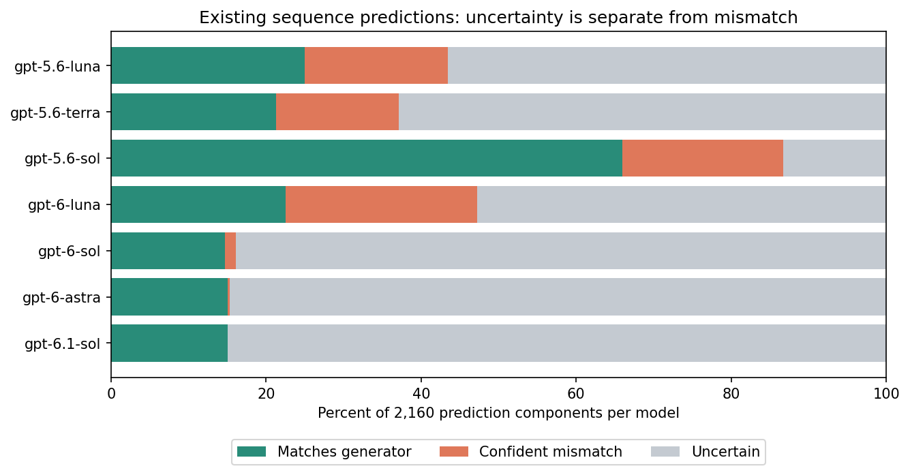
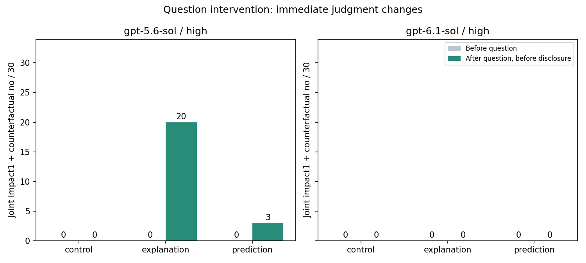

# Results and interpretation

This is the current reading guide to the preserved studies. Published reports, tables, and native data retain their original bytes. See the [study index](EXPERIMENTS.md) for design differences and the [methods](METHODS.md) for exact measures.

## Repetition, schedules, and persistence

Most single-round initial impact ratings were 100. Three repetitions reduced mean impact from 100 to 96.2 to 82.8. Later constant-versus-sequence studies showed a substantial condition difference.

| Large replication: round 10 | Joint report / conversations | Rate |
| --- | ---: | ---: |
| Constant target | 319/1,260 | 25.3% |
| Varying sequence | 1/1,260 | 0.08% |
| Cards, constant target | 217/630 | 34.4% |
| Cats, constant target | 102/630 | 16.2% |

Of 300 constant conversations whose first joint report occurred before round 10, 284 (94.7%) maintained it at every subsequent round. Sixteen reversed at least once. All nine sequence conversations with an intermediate joint report reversed at least once. Persistence after an early transition and the final endpoint are different summaries.

Frame effects varied by model. Constant-condition gpt-5.6-sol-high yielded 23/30 cards versus 22/30 cats; gpt-6-astra-high yielded 26/30 versus 3/30. More reasoning effort did not consistently increase joint reports: pooling frames, gpt-5.6-sol had 25 → 38 → 45 reports out of 60 from low to high, while gpt-6.1-sol had 29 → 26 → 10. These are not general intelligence rankings.

## Complete predictions versus uncertainty

Replication predictions followed an **explanation question and preceded actual rule disclosure**. Sequence conversations matched all 12 components in 97/1,260 cases (7.7%). **Calling the other 92.3% wrong is inaccurate.**

| Form among the 1,163 incomplete predictions | Conversations | Share of this subgroup |
| --- | ---: | ---: |
| All 12 uncertain | 541 | 46.5% |
| Partial matches plus uncertainty, no explicit mismatch | 343 | 29.5% |
| Explicit mismatch, no uncertainty | 230 | 19.8% |
| Explicit mismatch and uncertainty both present | 49 | 4.2% |

In this subgroup, 884/1,163 conversations (76.0%) contained no explicit mismatch. Of 542 conversations with zero matches, 541 abstained on every component; the remaining one had eight uncertain and four mismatching components. No conversation gave 12 explicitly mismatching answers.

### Response forms by model

Each model contributed 180 conversations. The four categories below are mutually exclusive. “Any mismatch” includes responses with and without uncertainty.

| Model | All 12 match | All uncertain | Partial match + uncertainty, no mismatch | Any mismatch |
| --- | ---: | ---: | ---: | ---: |
| gpt-5.6-luna | 7 | 69 | 36 | 68 |
| gpt-5.6-terra | 3 | 83 | 43 | 51 |
| gpt-5.6-sol | 87 | 15 | 13 | 65 |
| gpt-6-luna | 0 | 74 | 18 | 88 |
| gpt-6-sol | 0 | 101 | 74 | 5 |
| gpt-6-astra | 0 | 100 | 78 | 2 |
| gpt-6.1-sol | 0 | 99 | 81 | 0 |

[Machine-readable CSV](data/sequence-response-forms.csv). Of gpt-6.1-sol's 2,160 components, 324 matched, 1,836 were uncertain, and zero explicitly mismatched. No completely matching conversation does not mean no understanding.

### Uncertainty by reasoning effort

This is the percentage of prediction components answered `uncertain`. Each model/effort cell contains 60 conversations × 12 components = 720 components.

| Model | Low | Medium | High |
| --- | ---: | ---: | ---: |
| gpt-5.6-luna | 65.8% | 49.7% | 54.2% |
| gpt-5.6-terra | 61.9% | 64.2% | 62.6% |
| gpt-5.6-sol | 6.1% | 8.9% | 25.0% |
| gpt-6-luna | 83.3% | 59.2% | 15.8% |
| gpt-6-sol | 82.8% | 81.7% | 87.2% |
| gpt-6-astra | 85.0% | 82.5% | 86.7% |
| gpt-6.1-sol | 85.6% | 86.7% | 82.8% |

[All 21 configurations](data/sequence-uncertainty-by-effort.csv). gpt-6-sol, astra, and 6.1-sol generally abstained often, but neither model generation nor reasoning effort formed a uniform monotonic trend. Higher effort reduced abstention and increased mismatches in gpt-6-luna, whereas gpt-5.6-sol abstained more and mismatched less. These are observed response patterns, not causal rankings of general ability.

## Review of existing rule accounts

A single coordinator read the 97 fully matching conversations' accounts in randomized order with identifying labels removed. Forty accounts explicitly linked conditional keep/discard decisions to preserving a target; all were gpt-5.6-sol. The remaining 57 did not explicitly make that link. All 97 had immediately preceding round-10 self-reports of impact 100/yes.

Qualified possibilities count as proposed mappings, not certain knowledge. All 1,260 accounts received transparent lexical-feature analysis; 133 search candidates were also manually reviewed, with 56 meeting the mapping criterion. The screen can miss accounts and does not estimate the prevalence of internal knowledge. The coordinator knew aggregate results; this was not independent blinded validation or comprehensive right/wrong coding of all accounts.

[Coding method and limitations](../analysis/results/equivoque-2026-10-13-question-effect-v1/attempt-01/existing-analysis-method.json) · [97 original accounts and codes](../analysis/results/equivoque-2026-10-13-question-effect-v1/attempt-01/tables/existing_97_account_coding.csv)

## Question intervention: 180 conversations

Both models used high effort, cards, and sequence targets. Thirty case families shared arrangements and schedules across independent conversations. After round 10, a control, explanation, or prediction question preceded a common pre-disclosure rerating.

| Model | Control: subsequent 1/no | Explanation: subsequent 1/no | Prediction: subsequent 1/no |
| --- | ---: | ---: | ---: |
| gpt-5.6-sol | 0/30 | 20/30 | 3/30 |
| gpt-6.1-sol | 0/30 | 0/30 | 0/30 |

All 180 pre-question reports were impact 100/yes. For gpt-5.6-sol, the explanation-minus-control difference in pre/post change was +66.7 percentage points, with nominal pointwise paired-case 95% bootstrap interval [+46.7, +83.3]. The prediction contrast was +10.0 points, interval [0, +23.3].

gpt-6.1-sol's prediction arm changed impact 100 → 50 in all 30 conversations while retaining yes. Its explanation arm had five impact-50 and 25 impact-100 responses. **Zero joint transitions are not zero response change.** Whether 50 expressed uncertainty was not independently elicited.

In the latest prediction-only arm, three gpt-5.6-sol conversations matched all 12 components; all three immediately rerated to 1/no. The earlier explanation→prediction cohort's same model/effort/card/sequence cell had 19/30 complete matches. These were collected at different times and do not provide a randomized estimate of explanation's effect on prediction accuracy. The latest study directly isolates differences in subsequent self-report.

## Scope of the conclusions

- Repeated constant outcomes and a request to explain the procedure can support transitions in reported influence for some models.
- Post-disclosure reports of low influence alongside high selection freedom recur across game studies. They are judgments consistent with disclosed evidence, not a complete test of general understanding.
- Supplied-rule transfer accuracy of 98.45% concerns a different task from hidden-rule discovery.
- Rare sequence joint reports, proposed rule accounts, matching predictions, and abstention must remain distinct.
- The current evidence cannot separate already-held knowledge, newly elicited deductions, and a change in response policy.

Intervals are exploratory and nominal pointwise intervals. Boundary ratings can produce degenerate bootstrap intervals; observing 0/30 does not establish zero population probability. The studies do not directly establish human subjective experience, general intelligence rankings, or private model beliefs.
