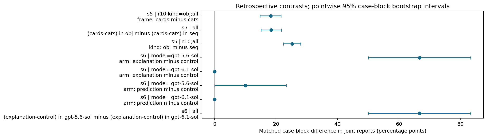
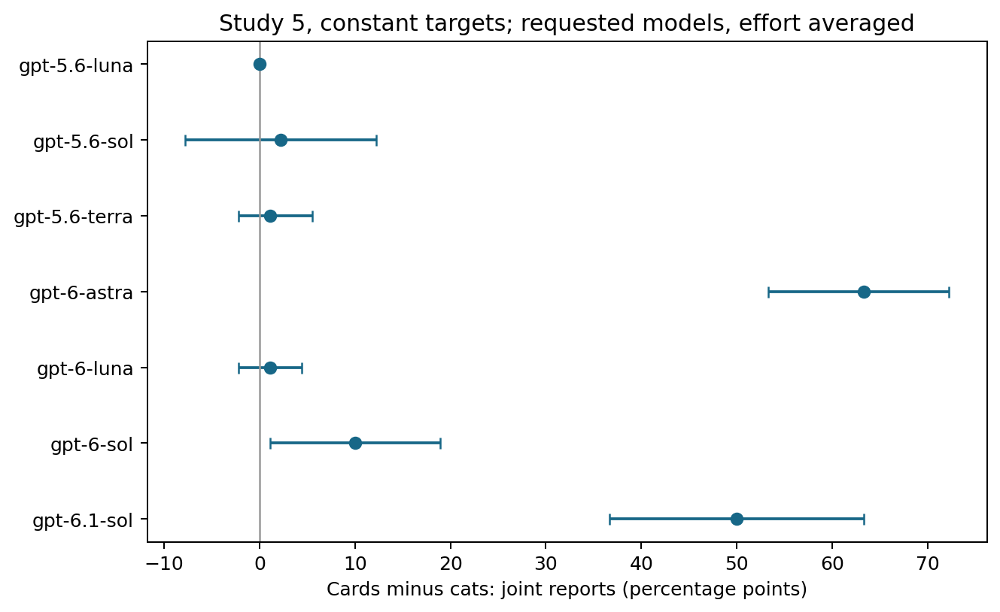
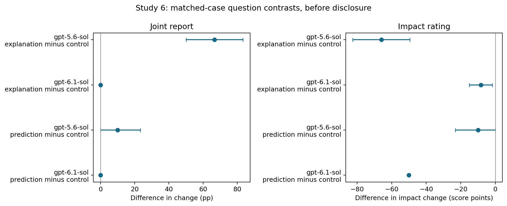

# Statistical supplement: six completed studies


Retrospective audit **2026-10-23-v1**; all outputs are derived from preserved local records. No new model calls.

[Methods, assumptions and multiplicity](STATISTICAL_METHODS.md) · [한국어 요약](STATISTICS.ko.md) · [Original studies](EXPERIMENTS.md)

## Read this first

These p-values are exploratory. The original outcomes were already known. The main analyses match conversations/tasks and then aggregate their differences within shared case families. The fixed requested-model panel is not a random sample of models. The primary p-values use **50, 10, 8, 30 and 30 case blocks** in Studies 1, 2, 3, 5 and 6. Study 4 has one shared case and only a separately labeled seven-model fixed-panel reference analysis.

Effects are case-weighted means. Bracketed intervals are nominal **pointwise** 95% intervals, not multiplicity-adjusted simultaneous intervals. A degenerate interval at a boundary does not establish zero population uncertainty. Global Holm p-values adjust over every estimable principal test, including omnibus and route tests.

## What the results support

- **Study 1:** the post-minus-pre impact contrast is -98.941 points [-98.998, -98.837]; global Holm p=5.132e-12. Initial ratings are almost all 100, limiting route comparisons. Disclosure also changes information, time and measurement.
- **Study 2:** round 3 minus round 1 is -17.207 points [-21.214, -13.200]; raw p=0.0020, global Holm p=1.0000. The descriptive reduction does not survive the full-audit correction; only ten case families are available.
- **Study 3:** supplied-rule transfer accuracy is 98.446%. Conflicting-minus-neutral is +0.050 pp [-0.496, +0.645]; global Holm p=1.0000. Eight case families and near-ceiling accuracy do not support an equivalence claim.
- **Study 4:** 5/14 constant-target versus 0/14 sequence conversations end at the joint endpoint. There is one shared case; the pilot does not supply replicated case-level inference.
- **Study 5:** constant-minus-sequence joint reports differ by +25.238 pp [+22.381, +28.016] (global Holm p=5.219e-06). Within constant targets, cards-minus-cats is +18.254 pp [+14.762, +21.587] (p=2.937e-05). The schedule-by-frame interaction also survives global correction (p=1.968e-05). Frames bundle nouns, labels, action verbs and feedback, so this does not isolate a noun-only effect.
- **Study 6:** gpt-5.6-sol's explanation-minus-control joint-report change is +66.667 pp [+50.000, +83.333] (global Holm p=0.0048); its prediction-minus-control difference has raw p=0.2500 and global Holm p=1.0000. For gpt-6.1-sol, prediction reduces impact by 50 points (global Holm p=5.219e-06) while joint reports stay at zero. This intermediate rating change is a distinct endpoint.

## Headline contrasts

| study | contrast | scope | metric | n_pairs | n_blocks | effect (95% CI) | raw p | global Holm p | headline Holm p |
| --- | --- | --- | --- | --- | --- | --- | --- | --- | --- |
| s1 | phase: post minus pre | all | impact | 2093.0 | 50 | -98.941 points [-98.998, -98.837] | 1.776e-15 | 5.132e-12 | 2.132e-14 |
| s2 | phase: r3 minus r1 | all | impact | 420.0 | 10 | -17.207 points [-21.214, -13.200] | 0.0020 | 1.0000 | 0.0098 |
| s3 | claim: conflicting minus neutral | all | transfer_accuracy | 672.0 | 8 | +0.050 pp [-0.496, +0.645] | 1.0000 | 1.0000 | 1.0000 |
| s4 | frame: cards minus cats | r30;kind=obj;all | joint | 7.0 | 7 | +14.286 pp [+0.000, +42.857] | 1.0000 | pilot reference only | — |
| s4 | kind: obj minus seq | r30;all | joint | 14.0 | 7 | +35.714 pp [+7.143, +71.429] | 0.2500 | pilot reference only | — |
| s5 | frame: cards minus cats | r10;kind=obj;all | joint | 630.0 | 30 | +18.254 pp [+14.762, +21.587] | 1.118e-08 | 2.937e-05 | 8.941e-08 |
| s5 | (cards-cats) in obj minus (cards-cats) in seq | all | joint | 630.0 | 30 | +18.413 pp [+15.079, +21.746] | 7.451e-09 | 1.968e-05 | 6.706e-08 |
| s5 | kind: obj minus seq | r10;all | joint | 1260.0 | 30 | +25.238 pp [+22.381, +28.016] | 1.863e-09 | 5.219e-06 | 2.049e-08 |
| s6 | arm: explanation minus control | model=gpt-5.6-sol | joint | 30.0 | 30 | +66.667 pp [+50.000, +83.333] | 1.907e-06 | 0.0048 | 1.335e-05 |
| s6 | arm: explanation minus control | model=gpt-6.1-sol | joint | 30.0 | 30 | +0.000 pp [+0.000, +0.000] | 1.0000 | 1.0000 | 1.0000 |
| s6 | arm: prediction minus control | model=gpt-5.6-sol | joint | 30.0 | 30 | +10.000 pp [+0.000, +23.333] | 0.2500 | 1.0000 | 1.0000 |
| s6 | arm: prediction minus control | model=gpt-6.1-sol | impact | 30.0 | 30 | -50.000 points [-50.000, -50.000] | 1.863e-09 | 5.219e-06 | 2.049e-08 |
| s6 | arm: prediction minus control | model=gpt-6.1-sol | joint | 30.0 | 30 | +0.000 pp [+0.000, +0.000] | 1.0000 | 1.0000 | 1.0000 |
| s6 | (explanation-control) in gpt-5.6-sol minus (explanation-control) in gpt-6.1-sol | all | joint | 30.0 | 30 | +66.667 pp [+50.000, +83.333] | 1.907e-06 | 0.0048 | 1.335e-05 |

## Complete coverage

| study | tests | estimable | principal globally adjusted p < .05 |
| --- | --- | --- | --- |
| s1 | 529 | 529 | 87.0 |
| s2 | 770 | 770 | 2.0 |
| s3 | 276 | 276 | 1.0 |
| s4 | 360 | 45 | 0.0 |
| s5 | 1184 | 1184 | 324.0 |
| s6 | 130 | 130 | 61.0 |

This table counts scripted audit comparisons, not discoveries or independent scientific claims. Constant/no-difference tests remain in the multiplicity family. See the full tables for all null results and limitations.

## Figures







## Data and reproducible outputs

All result files are in [the supplement directory](data/statistics-2026-10-23).

- [contrasts.csv](data/statistics-2026-10-23/contrasts.csv): All paired, route and omnibus tests; raw/adjusted p-values, effects, intervals, units and status.
- [case_blocks.csv](data/statistics-2026-10-23/case_blocks.csv): The actual case-block differences used by paired tests.
- [sensitivity_mcnemar.csv](data/statistics-2026-10-23/sensitivity_mcnemar.csv): Exact McNemar sensitivities, discordant pairs and stable log p-values.
- [descriptives.csv](data/statistics-2026-10-23/descriptives.csv): All cell, model, condition and overall endpoint summaries.
- [source_manifest.json](data/statistics-2026-10-23/source_manifest.json): Input SHA-256, row counts, columns, versions, analysis seed and code hashes.
- [validation.json](data/statistics-2026-10-23/validation.json): Assertions that the six historical denominators and key aggregates match.
- [rule_coding_descriptive.csv](data/statistics-2026-10-23/rule_coding_descriptive.csv): Selected account coding, descriptive only.
- [report.html](data/statistics-2026-10-23/report.html): Offline searchable/filterable table; download and open locally.
- [reproduction.json](data/statistics-2026-10-23/reproduction.json): Deterministic output hashes; use --check to compare a fresh generation.

## Interpretation boundaries

- The joint endpoint is an impact-1/counterfactual-no **report**, not private knowledge. Prediction matches concern the actual generator; other generators can be observationally compatible. Uncertainty is not an explicit mismatch.
- Studies 1–2 disclosure/time contrasts do not isolate causal effects of disclosure or repetition. Routes are endogenous associations.
- Study 3 has eight case families and near-ceiling supplied-rule accuracy. Non-significant host-claim contrasts are not equivalence findings.
- Model and effort contrasts describe requested configurations on these cases, not general intelligence or independently attested internal model versions.
- Existing account coding is a single-coordinator, selected review without independent gold-standard validation; no latent-knowledge significance test is attached.
- Do not compare the older explanation→prediction cohort with the newer prediction-only arm as a randomized order experiment.

### Persistence: descriptive, conditional on an early transition

| kind | early_joint_conversations | persistent | persistent_rate |
| --- | --- | --- | --- |
| obj | 300 | 284 | 0.9466666666666667 |
| seq | 9 | 0 | 0.0 |

Conditioning on an observed early transition changes the population and opportunity to reverse. These selected denominators are retained descriptively rather than treated as randomized groups.

## Reproduce

```bash
python -m pip install -r analysis/requirements-statistics.txt
python -m unittest discover -s tests -p 'test_statistics.py' -v
python scripts/statistical_audit.py --check
python scripts/validate_repository_docs.py
```

A plain run regenerates only the new supplement. `--check` regenerates into a temporary directory and verifies every published supplement byte and generated guide. Monte Carlo reference distributions use 99,999 resamples; bootstrap intervals use 20,000. Seeds derive deterministically from each contrast ID. Byte-for-byte verification requires the recorded Python/library/font environment. The script imports no runner/transport and depends only on local CSV exports; it does not require a model login.
