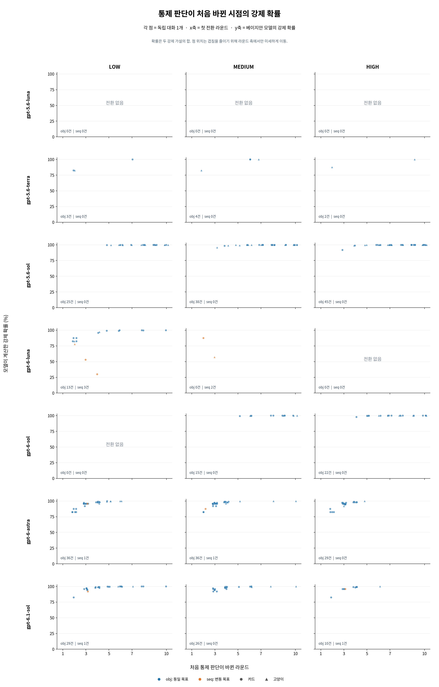

# 실험 5 재분석: 통제 판단 전환 시점의 베이지안 확률

이 폴더는 **기존 실험 5 자료를 이용한 탐색적 분석**이다. 7개 모델 × 3개 추론 수준별로, 각 독립 대화에서 처음 `impact=1`과 `counterfactual=no`가 함께 나온 라운드에 임시 베이지안 모델이 계산한 강제 확률을 표시한다. 새 LLM 호출은 없다.

## 그래프

라운드별 개별 대화의 K/D 경로와 확률 변화: [21개 모델·추론 조합별 그래프](trajectories/README.md)

별도 50:50 K/D 예측 모델의 라운드별 surprisal: [21개 모델·추론 조합별 그래프](kd_surprisal/README.md)

- [전체 그래프](collapse_all.png) · [90–100% 확대](collapse_zoom.png) · [두 그래프 PDF](collapse_plots.pdf)
- [342개 전환점 데이터](collapse_points.csv)
- 색: 파랑은 동일 목표(obj), 주황은 변동 목표(seq). 모양: 원은 카드, 삼각형은 고양이.
- 점 하나는 첫 공동 보고가 관찰된 대화 하나다. 겹침을 줄이기 위해 **가로 위치만** 해당 라운드 근처에서 조금 이동했다. 세로 확률은 이동하지 않았다.
- 확대 그래프는 90% 미만인 29개 점을 표시하지 않는다. 패널에 적은 건수는 확대 범위 밖을 포함한다. `전환 없음`은 10라운드 안에 공동 보고가 없었다는 뜻이다.

## 해석과 한계

- 전환점은 총 342건(동일 목표 333, 변동 목표 9)이다. 95% 이상은 296건, 99% 이상은 187건이다.
- 이 그림은 **전환한 대화만** 표시한다. 동일 목표 조건에서 927개 대화는 이 모델의 강제 확률이 95%에 도달했지만 10라운드까지 공동 보고가 나타나지 않았다. 점들이 모여 있다는 사실만으로 임계값을 확정할 수 없다.
- 세로축은 실제 LLM의 내적 확신이 아니다. 아래에 명시된 가설과 사전확률을 이용해 실험자가 계산한 확률이다. 100%에 가까운 점들은 동일 결과가 반복될 때 모델 확률이 포화되는 특성에도 영향을 받는다.
- 공동 보고는 응답 지표다. 인간과 동일한 주관적 SoA, 실제 뇌파, 잠재적 규칙 지식을 직접 측정하지 않는다. 카드를 예측하는 능력과도 별개다.
- 본 분석은 기존 결과를 이미 알고 수행했으며, 사전등록한 새 자료 검증이 아니다. 30개의 사례 패밀리가 조건·모델 전반에 공유된다. 전환 없는 대화와 시점별 위험을 함께 분석해야 한다.

## 임시 베이지안 모델

세 경쟁 가설의 초기 확률은 각 1/3이다.

1. **고정 목표 강제:** 숨은 목표 하나가 유지되며 매 라운드 95%는 그 목표, 5%는 네 결과 중 균등 무작위라고 가정한다.
2. **변동 목표 강제:** 각 라운드 목표가 독립적이고 균등하다고 가정한다. 이는 실제 실험 5의 사전 배정된 균형 일정에 대한 단순 근사다.
3. **선택 의존 K/D:** K/D 전환에 대한 확률이 고정되어 있으나 알려져 있지 않고, 각 전환 맥락에 Beta(1,1) 사전을 둔다. 첫 단계는 이전 라운드 첫 단계에, 둘째 단계는 같은 라운드 첫 단계에 조건화한다.

매 라운드 기록의 가설별 우도로 사후확률을 업데이트한다. 세로축은 **고정 목표 강제와 변동 목표 강제 가설의 사후확률 합**이다. 선택과 K/D가 최종 결과를 결정하므로, 최종 결과를 독립적인 증거로 중복해 곱하지 않는다. 두 강제 가설은 관찰만으로 선택 의존 확률적 게임과 구별되지 않는 경우가 있다. 출력 확률은 이 가정들에 민감하며 실제 생성 규칙의 증거나 확정된 임계값이 아니다.

## 재생성

저장소 루트에서 `python docs/data/exp5-bayesian-collapse-20261111/bayesian_prototype.py`로 라운드별 확률을 계산한 다음 `python docs/data/exp5-bayesian-collapse-20261111/plot_collapse.py`로 그래프를 생성한다. `numpy`, `pandas`, `matplotlib`, Noto Sans CJK 글꼴이 필요하다. 계산은 저장소의 보존된 `analysis/results/equivoque-2026-10-12-sequence-replication-v1/attempt-01/tables/`만 읽는다. 시스템별 글꼴·라이브러리에 따라 이미지 바이트는 달라질 수 있다.
