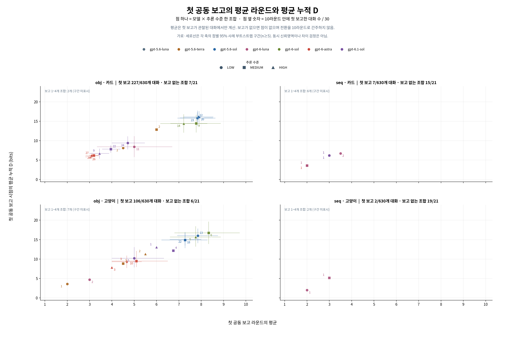

# 평균 누적 D와 평균 첫 전환 라운드

각 모델 × 추론 수준·소재·obj/seq 조건에서 **처음 공동 보고가 나온 대화의 평균 전환 라운드와 그 시점의 평균 누적 D**를 한 점으로 표시한다. 전환이 10라운드까지 관찰되지 않은 대화 수도 별도 그림에 포함한다. 기존 실험 5의 탐색적 재분석이며 새 LLM 호출은 없다.

[평균 라운드–평균 D 그래프](mean_d_vs_mean_round.png) · [전환 유무와 건수 그래프](reported_and_unreported_counts.png) · [두 그래프 PDF](mean_d_vs_round_and_counts.pdf) · [조합별 집계 CSV](mean_d_and_round.csv) · [첫 보고점 데이터](first_report_points.csv)

[같은 모델을 연결한 그래프](mean_d_vs_mean_round_connected.png) · [연결 그래프 PDF](mean_d_vs_mean_round_connected.pdf) · [연결 여부 CSV](connected_edges.csv)

## 읽는 법

- 패널은 카드·고양이와 obj·seq를 나눈다. 색은 모델, 점 모양은 추론 수준이다. 점 하나는 한 조건의 모델 × 추론 수준 한 조합이다.
- 연결 그래프는 각 패널에서 같은 모델의 low–medium과 medium–high를 연결한다. 한쪽 수준에서 보고가 없으면 선을 끊고, 중간 수준을 건너뛰어 연결하지 않는다. 각 점은 별도 대화들의 평균이므로 선은 개별 대화의 시간 경로나 추론 수준의 인과효과를 뜻하지 않는다.
- X축은 `impact=1 AND counterfactual=no`가 처음 함께 나타난 라운드의 평균이다. Y축은 **같은 각 대화의 그 전환 시점**에 계산된 누적 surprisal D의 평균이다. 각 점 옆 숫자는 전환이 관찰된 대화 수이며 각 조건은 30개 대화다.
- 실제 첫 공동 보고를 한 대화만 두 평균의 분모에 포함한다. 10라운드까지 보고가 없으면 이후 시점이 알려지지 않은 관측이므로, 임의로 10라운드에서 전환한 것으로 넣지 않는다. 해당 조건에서 보고가 0개이면 평균을 계산할 수 없어 점이 없다.
- 전환 유무 그림의 색 막대는 보고가 있던 대화 수이고 회색 막대는 10라운드까지 없던 대화 수다. 2,520개 대화 중 342개에서 첫 공동 보고가 있었고 2,178개에서는 관찰되지 않았다. 조건 84개 중 47개는 보고가 0개, 17개는 1~4개다.
- 평균 그래프의 가로·세로 구간은 각 축에 대한 **점별 95% 사례 패밀리 부트스트랩 구간**이다. 같은 30개 사례 패밀리를 5,000회 복원 추출하며, 한 재표본에서의 라운드와 D는 같은 대화를 함께 유지한다. 첫 보고가 5개 미만인 조건은 표본이 적어 구간을 그리지 않는다. 구간이 없다는 것이 오차가 없다는 뜻은 아니다. 이 선은 두 축의 동시 신뢰영역이나 집단 차이 검정이 아니다.

## 주의할 점

누적 D는 [시간순 K/D 예측 모델](../temporal_kd_model/README.md)의 `−log2 P(관측)`을 더한 값이다. 예상에 맞은 피드백에서도 대체로 증가하므로, **평균 전환 라운드가 늦은 조합의 평균 D도 커지는 관계는 시간 축적만으로 생길 수 있다.** 산점도의 우상향을 공통 임계값이나 인과관계로 해석할 수 없다.

첫 공동 보고가 있었던 대화만 대상으로 한 평균은 전환이 없었던 대화를 대표하지 않는다. 모델별 조건별 전환율과 10라운드 관측 한계를 함께 봐야 한다. seq의 첫 보고는 전체 1,260개 대화 중 9개여서 조합별 값이 특히 불안정하다. 모델 확률과 D는 실제 LLM의 내적 믿음이나 인간의 주관적 SoA를 직접 측정하지 않는다.

## 재생성

저장소 루트에서 `python docs/data/exp5-bayesian-collapse-20261111/generate_temporal_kd_model.py`를 실행한 뒤 `python docs/data/exp5-bayesian-collapse-20261111/generate_mean_d_vs_round.py`를 실행한다. `numpy`, `pandas`, `matplotlib`과 Noto Sans CJK 글꼴이 필요하다. 보존된 실험 기록만 읽는다.

연결 그래프는 위의 집계를 만든 후 `python docs/data/exp5-bayesian-collapse-20261111/generate_mean_d_vs_round_connected.py`로 재생성한다. 기존 평균과 구간을 그대로 읽는다.
