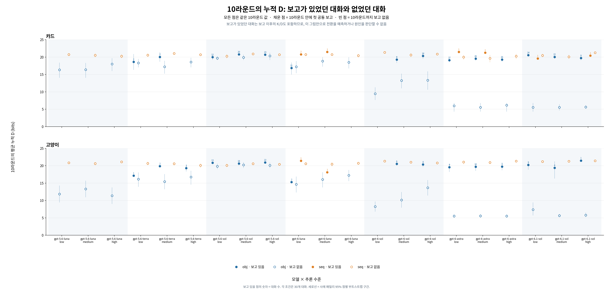

# 전환하지 않은 대화를 포함한 누적 D 비교

실험 5의 **2,520개 대화 전체**를 사용한다. 10라운드 안에 `impact=1 AND counterfactual=no`가 처음 관찰된 대화는 342개, 그때까지 관찰되지 않은 대화는 2,178개다. 별이 없는 대화를 0으로 처리하거나 분석에서 삭제하지 않는다.

## 1. 같은 10라운드에서 비교

[이미지](round10_report_vs_no.png) · [PDF](round10_report_vs_no.pdf) · [값과 표본 수](round10_report_vs_no.csv)

모든 점의 Y축은 **10라운드의 D**다. 채운 점은 10라운드 안에 첫 공동 보고가 있었던 대화의 평균, 빈 점은 10라운드까지 없었던 대화의 평균이다. 파랑은 obj, 주황은 seq이며 카드·고양이는 별도 패널이다. 채운 점 위 숫자는 보고가 있었던 대화 수다. 각 셀은 30개 대화이므로 보고 없는 대화 수는 30에서 이 숫자를 뺀 값이다.

이 그래프는 서로 다른 라운드의 D를 비교하지 않는 대신, **보고가 있었던 대화에는 보고 이후의 K/D도 포함**한다. 10라운드 값의 차이를 보고 이전의 원인이나 전환 예측으로 해석해서는 안 된다. 첫 보고 이후 다시 응답이 바뀌더라도 이 그림에서는 `10라운드 안에 첫 보고가 있었던 대화`로 분류한다.

## 2. 매 라운드의 같은 시점에서 비교

각 모델·추론 수준을 선택하면 obj/seq × 카드/고양이 네 패널이 나온다.

| 모델 | Low | Medium | High |
| --- | --- | --- | --- |
| gpt-5.6-luna | [Low](gpt-5.6-luna-low-same-round.png) | [Medium](gpt-5.6-luna-medium-same-round.png) | [High](gpt-5.6-luna-high-same-round.png) |
| gpt-5.6-terra | [Low](gpt-5.6-terra-low-same-round.png) | [Medium](gpt-5.6-terra-medium-same-round.png) | [High](gpt-5.6-terra-high-same-round.png) |
| gpt-5.6-sol | [Low](gpt-5.6-sol-low-same-round.png) | [Medium](gpt-5.6-sol-medium-same-round.png) | [High](gpt-5.6-sol-high-same-round.png) |
| gpt-6-luna | [Low](gpt-6-luna-low-same-round.png) | [Medium](gpt-6-luna-medium-same-round.png) | [High](gpt-6-luna-high-same-round.png) |
| gpt-6-sol | [Low](gpt-6-sol-low-same-round.png) | [Medium](gpt-6-sol-medium-same-round.png) | [High](gpt-6-sol-high-same-round.png) |
| gpt-6-astra | [Low](gpt-6-astra-low-same-round.png) | [Medium](gpt-6-astra-medium-same-round.png) | [High](gpt-6-astra-high-same-round.png) |
| gpt-6.1-sol | [Low](gpt-6.1-sol-low-same-round.png) | [Medium](gpt-6.1-sol-medium-same-round.png) | [High](gpt-6.1-sol-high-same-round.png) |

[21개 조합 PDF](same_round_all_21.pdf) · [라운드별 집계와 표본 수](same_round_risk_sets.csv) · [모델·전체 라운드 데이터](../temporal_kd_model/README.md)

각 라운드에서 **이전 라운드까지 첫 공동 보고가 없었던 대화만** 비교한다.

- **빨간 별:** 해당 라운드에 첫 공동 보고가 나온 대화들의 평균 D. 별 옆 숫자는 대화 수다.
- **파란 선:** 해당 라운드가 끝날 때까지 아직 첫 공동 보고가 없었던 대화들의 평균 D. 전환하지 않은 대화뿐 아니라, 나중 라운드에 처음 전환할 대화도 그때까지 포함한다.
- 이미 첫 공동 보고를 한 대화는 다음 라운드부터 제외한다. 따라서 파란 선은 같은 대화 집합을 영구적으로 추적한 평균이 아니며, 시간이 지나며 포함 대화가 달라진다.
- 그 라운드 K/D 피드백과 결과를 본 후, 공동 보고에 답하기 전까지의 D를 사용한다. 빨간 별이 없는 라운드는 보고 사건이 없어 평균을 계산할 수 없다는 뜻이다.

## 구간과 해석

세로선과 파란 음영은 각 조건의 원래 **30개 사례 패밀리 단위 3,000회 부트스트랩 점별 95% 구간**이다. 매 재표본에서 해당 라운드의 위험집합과 보고 여부를 적용한다. 해당 집단이 한 대화뿐이면 구간을 표시하지 않고, 0개면 평균도 없다. 표본이 작으면 구간이 불안정할 수 있으며, 점별 구간은 다중 비교를 보정한 조건 차이 검정이 아니다.

공동 보고는 실제 LLM의 내적 확신이나 인간의 주관적 SoA를 직접 측정하지 않는다. D는 시간순 K/D를 사용한 임시 베이지안 모델의 누적 surprisal이고, 예상한 사건에서도 증가할 수 있다. 같은 라운드에서의 기술적 차이만으로 D가 보고를 일으켰거나 공통 임계점이 존재한다고 결론 내릴 수 없다. obj/seq의 결과 반복은 이 K/D 전용 D에 입력하지 않았다.

## 재생성

저장소 루트에서 `python docs/data/exp5-bayesian-collapse-20261111/generate_temporal_kd_model.py`를 실행한 뒤 `python docs/data/exp5-bayesian-collapse-20261111/generate_no_report_comparison.py`를 실행한다. 기존 실험 자료를 읽으며 새 LLM 호출은 없다.
